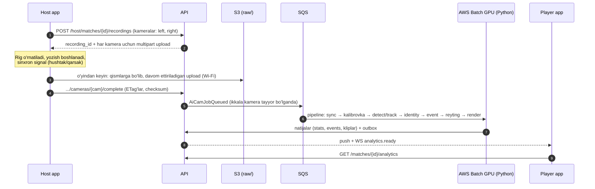
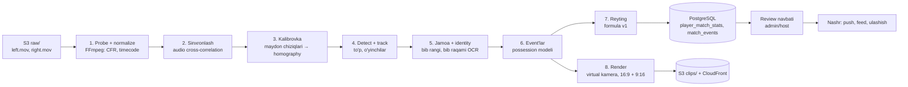

# AI-Cam Engine — video highlight'lar va o'yinchi reytingi

> Maydondagi 2–3 telefon yozuvidan butun maydon ko'rinishi, avtomatik highlight kliplar (gol, dribling, progressiv pas) va har bir o'yinchi uchun FIFA uslubidagi reyting (masalan, **8.7**) yaratadigan modul.
> Holat: **Bosqich A — tayyor** (migratsiya `0006`, API, worker profillari `recording_v1` / `clip_v1`, host'da kamera rejimi va pult, player'da to'liq o'yin videosi; §12). Haqiqiy telefonda 90 daqiqalik yozuv bilan pilot — keyingi qadam. Bosqich B–D — reja.

| Bog'liq joy | Nima bor |
|---|---|
| `highlights`, `media_assets` (0001) | klip va fayl yozuvlari |
| `match_events` (0002) | `source = 'ai'`, `confidence`, `match_offset_ms` |
| `media_processing_jobs` (0002, 0008) | `ai_detect_events`, `ai_auto_clip`, `face_blur` job turlari; 0008 dan `stage`, `transport` (`redis_stream` / `sqs`), `message_id`, `heartbeat_at` |
| `services/media-worker` | Python worker (highlight transcode, `ARCHITECTURE.md` §4.10): `JobSource` (navbat), `Api` (ichki endpointlar), `Storage` (S3), idempotent bosqichli `Pipeline` — AI-Cam `services/ai-cam` shu qatlamlar ustiga quriladi |
| API Media moduli | presigned multipart (resume bilan), `MediaJobQueue` + `JOB_ROUTES` (`ai_*` → `sqs`), `/internal/media/jobs/{id}/start\|progress\|result`, HLS playlist imzolash |

---

## 1. Maydondagi ish oqimi



**Rig (host olib yuradigan to'plam):**
- 5 metrli teleskopik shtativ markaziy chiziqda, maydon chetida. 2 ta telefon (iPhone 11+): **A** — chap yarim maydon, **B** — o'ng yarim maydon. Markaziy doira atrofida ikkala kadr ~10–15% ustma-ust tushadi (kalibrovka va stitching uchun).
- Ixtiyoriy 3-telefon: keng burchakli umumiy kadr (zaxira va sinxronlash uchun).
- **Raqamli bib'lar** (oldi va orqasida katta raqam, ikki rang). Pickup o'yinlarda futbolka raqami yo'q, shuning uchun o'yinchini tanish faqat bib raqami orqali ishonchli ishlaydi. Host check-in paytida har o'yinchiga bib raqamini biriktiradi (§5).
- Power bank va soya: 90+ daqiqa 4K yozuvda iPhone qiziydi. Yozda Toshkentda 40°C — bu real xavf (§10).

**Yozish sozlamalari (host app yozadi, oddiy kamera ilovasi emas):**
- 4K 30 fps HEVC, ekspozitsiya va fokus qulflangan, stabilizatsiya o'chiq. Stabilizatsiya kadrni siljitib, kalibrovkani buzadi.
- Boshlashdan oldin tekshiruvlar: bo'sh joy ≥ 40 GB, batareya ≥ 80% yoki quvvatga ulangan, ikkala telefon soati NTP bo'yicha.
- Hajm: ~15 GB / telefon / 90 daqiqa → bitta match ≈ 30 GB. Mobil internet orqali yuklash amalda imkonsiz. Upload Wi-Fi'da, fonda, qismlarga bo'lib va uzilsa davom ettiriladigan (resumable) bo'ladi. Fayl serverda checksum tasdiqlanmaguncha telefondan o'chirilmaydi.

## 2. Pipeline arxitekturasi



**Navbat va compute:**
- Core API'da BullMQ ishlatiladi, lekin u faqat Node.js uchun. Python GPU worker'lar uchun **SQS + AWS Batch** (spot GPU, ishsiz paytda 0 instance) tanlanadi. API job'ni `media_processing_jobs` ga yozadi va SQS'ga xabar yuboradi; holat har bosqichda shu jadvalda yangilanadi.
- Har bosqich alohida va qayta boshlanadigan (idempotent) bo'ladi. Bosqich natijalari S3'ga yoziladi: `work/{recording_id}/{stage}/…`. 6-bosqich xato bersa, detection qayta ishlanmaydi.
- GPU image: CUDA + ONNX Runtime yoki TensorRT, FFmpeg NVENC bilan. Instance: `g6.xlarge` (L4) yoki `g5.xlarge` (A10G), spot.
- Region: `eu-central-1` (§4.3). Yuzni tanish ishlatilmaydi, shuning uchun bu biometrik qayta ishlash emas (§8).

**"Stitching" haqida aniqlik.** Tahlil uchun 4K panorama shart emas. Har kamera o'z **homography**'si bilan maydon tekisligiga (metrlardagi 2D koordinatalar) proyeksiya qilinadi. Shu tufayli ikkala kameradagi detection'lar bitta koordinata tizimida birlashadi, progressiv pas kabi metrikalar esa metrda hisoblanadi.

Panorama (OpenCV: maydon chiziqlari bo'yicha moslash, ustma-ust qismda SIFT/ORB, seam blending) faqat **chiqish videosi** uchun yasaladi:
- to'liq o'yin replay'i (2×4K → ~5K panorama, keyin 1080p/1440p ga kichraytiriladi);
- kliplar uchun **virtual kamera** — to'p ortidan silliq yuruvchi crop (Veo/Trace kabi).

## 3. Computer vision modellari

| Vazifa | Yondashuv | Eslatma |
|---|---|---|
| O'yinchi va to'p detection | Fine-tune qilingan detector. Kandidatlar: **RT-DETR** yoki **YOLOX** (Apache-2.0) yoki YOLOv8/YOLO11 | ⚠️ Ultralytics YOLOv8/YOLO11 — **AGPL-3.0**, YOLOv10 ham shu kodga asoslangan. Yopiq kommersiya mahsulotida ishlatish uchun Ultralytics Enterprise litsenziyasi kerak, aks holda Apache-2.0 modellar olinadi. Tanlov pilot benchmark'idan keyin. |
| To'p (kichik obyekt) | Yuqori aniqlikdagi tile'lar (SAHI uslubi), to'pga alohida model, Kalman filtr + yo'qolgan kadrlarda interpolyatsiya | 4K'da to'p 10–20 px. Panjara (qafas maydonlar) va tungi yoritish asosiy xato manbalari. |
| Tracking | **ByteTrack** (MIT) yoki BoT-SORT; har kamera alohida, keyin pitch koordinatalarida birlashtiriladi | DeepSORT'ning tashqi ko'rinish embedding'lari faqat ishlov paytida, keyin o'chiriladi (§8). |
| Kalibrovka | Maydon chiziqlari va burchak keypoint modeli + RANSAC homography; kamera qimirlasa, har N soniyada qayta baholanadi | Maydon o'lchamlari `pitches.length_m/width_m` dan olinadi. |
| Jamoa | Tors crop'laridagi rang bo'yicha K-means. Bib ranglari oldindan ma'lum (`match_sides.bib_color`) | Hakam yoki tomoshabin — 3-klaster yoki maydondan tashqarida. |
| Identity | Bib raqami **OCR** (PARSeq/CRNN, bib raqamlariga fine-tune qilingan) + track bo'ylab ovoz berish → `match_participants.bib_number` | Aniqlanmagan track'lar review navbatiga tushadi va host/admin uni bir bosishda o'yinchiga bog'laydi. |

## 4. Event'lar va reyting

**Possession modeli:** har kadr uchun to'pga eng yaqin o'yinchi (≤ 1.5 m, pitch koordinatalarida) va to'p tezligi → possession segmentlari. Event'lar segmentlar orasidagi o'tishlardan chiqariladi:

| Event | Qoida (v1, kichik maydonlar uchun masshtablanadi) | `match_event_type` |
|---|---|---|
| Pas | possession bir jamoa ichida A → B o'tadi | `pass` |
| Progressiv pas | to'p raqib darvozasi tomon ≥ 25% qolgan masofaga yoki oxirgi uchdan birga o'tadi | `progressive_pass` |
| Key pas | pasdan keyin ≤ 3 s ichida zarba | `key_pass` |
| Muvaffaqiyatli dribling | olib yurish paytida ≤ 2 m'dagi raqib orqada qoladi va possession ≥ 1.5 s saqlanadi | `dribble_success` / `dribble_fail` |
| To'p yo'qotish | o'yinchi tekkandan keyin ≤ 2 s ichida possession raqibga o'tadi | `turnover` |
| Zarba | to'p tezligi keskin oshadi va darvoza sektoriga yo'naladi | `shot`, `shot_on_target` |
| Gol | to'p kalibrovkada belgilangan darvoza chizig'ini ustunlar orasidan kesib o'tadi | `goal` (bor) |

Gollar host kiritgan hisob bilan solishtiriladi: hisob mos kelmasa, match review'ga tushadi. Foul va kartochkalarni videodan ishonchli aniqlab bo'lmaydi — ular host'ning `incidents` ma'lumotidan olinadi.

**Reyting formulasi v1** (sozlanadigan, `rating_formulas` jadvalida versiyalangan):

```
rating = clamp(6.0 + Σ(weight[e] × confidence[e]) + team_result, 3.0, 10.0), 0.1 gacha yaxlitlanadi
```

| Event | Og'irlik | Event | Og'irlik |
|---|---|---|---|
| Gol | +1.2 | To'p yo'qotish | −0.2 |
| Assist | +0.8 | Muvaffaqiyatsiz dribling | −0.1 |
| Key pas | +0.5 | Avtogol | −1.0 |
| Muvaffaqiyatli dribling | +0.2 | Foul (host) | −0.4 |
| Progressiv pas | +0.15 | Sariq / qizil (host) | −0.5 / −1.5 |
| Darvozaga zarba | +0.2 | G'alaba / mag'lubiyat | +0.3 / −0.2 |

- O'yinchi kamroq o'ynagan bo'lsa (almashinuvlar), hissa o'ynagan daqiqalar bo'yicha normallashtiriladi.
- Har reyting bilan `rating_breakdown` (qaysi event qancha qo'shdi) saqlanadi. Shunda ilovada "Nega 7.8?" deb so'ralganda tushuntirish mumkin.
- Bu **o'yin reytingi** — matchmaking'dagi Glicko darajasidan (`player_sport_profiles.rating`) alohida. Keyinchalik unga past og'irlikdagi signal sifatida qo'shilishi mumkin.

**Overlay matnlari** lokalizatsiya qilinadi: "MUVAFFAQIYATLI DRIBLING" / "УСПЕШНЫЙ ДРИБЛИНГ" / "SUCCESSFUL DRIBBLE".

### O'yinchi videosi (player reel) — Bosqich C

Bitta o'yinchining match'dagi lahzalari bitta videoda (scouting videolari uslubida), ulashish uchun — 9:16 va 1:1:

- **Manba:** shu o'yinchining `match_events` lari vaqt tartibida, har biri virtual kamera render'idan (§2, 8-bosqich) event atrofidagi oyna bilan. Davomiyligi ≤ 2–3 daqiqa: ko'p bo'lsa, og'irligi (§4 jadvali) yuqori event'lar tanlanadi.
- **Overlay:**
  - yuqori chapda — avatar (faqat o'yinchi o'zi yuklagan profil rasmi), ism, bib raqami va **jonli reyting**: 6.0 dan boshlanadi, har event'dan keyin `rating_breakdown` bo'yicha yangilanadi; rang — qizil (< 6), sariq (6–7), yashil (7–8), ko'k (≥ 8);
  - o'yinchi ustida ▼ belgisi va ismi — tracking natijasi (pitch koordinatalari kamera kadriga qayta proyeksiya qilinadi, silliqlanadi);
  - event yozuvi va `rating_delta` ("+GOL +1.2", "+MUVAFFAQIYATLI DRIBLING +0.2"); salbiy event'da ("−TO'P YO'QOTISH") qisqa qizil fon;
  - pastda jamoalar (bib ranglari bilan), yuqori o'ngda venue/match;
  - oxirgi kadr — yakuniy reyting kartochkasi (avatar, ism, reyting, Match Up brendi).
- **Qachon yaratiladi:** reyting `published` bo'lgandan keyin (shadow rejimda yo'q); reyting `disputed` bo'lsa reel nashrdan olinadi va qayta render qilinadi.
- **Sifat sharti:** reel'dagi eng ko'rinadigan xato — ▼ belgisining boshqa o'yinchida turishi. Shuning uchun reel faqat identity'si ishonchli (bib OCR ovozi chegaradan yuqori yoki review'da tasdiqlangan) track segmentlaridan yig'iladi.
- **Maxfiylik (§8):** faqat `media_appearance` roziligi bor o'yinchi uchun; kadrdagi boshqa o'yinchilar nomlanmaydi va belgilanmaydi, roziligi yo'qlarning yuzi xiralashtiriladi (`face_blur`).

## 5. DB kengaytmasi (faqat additive)

**Bosqich A — `0006_ai_cam.sql` (qo'llangan).** Raqam 0007/0008 dan oldin: toza bazada 0006 ulardan oldin ishlaydi, shuning uchun faqat 0001–0005 obyektlariga tayanadi. Holatlar `text + CHECK` — keyingi bosqichlar CHECK'ni almashtirib qiymat qo'shadi (enum `ADD VALUE` tranzaksiya muammosisiz).

| Jadval / o'zgarish | Asosiy ustunlar |
|---|---|
| `match_participants` + `bib_number smallint` (1–99) | partial UNIQUE (match_id, bib_number) faol roster qatorlari orasida — host check-in'da biriktiradi |
| `recording_sessions` (yangi) | match_id UNIQUE, host_user_id, status (`recording → uploading → processing → ready / failed`, kameralardan hisoblanadi), rig_type, kickoff_at (birinchi `kickoff` belgisi), ready_at (birinchi kamera tayyor — `RecordingReady` bir marta) |
| `recording_cameras` (yangi) — har telefonning **har fayli** (qizib to'xtasa — yangi fayl, o'sha pozitsiya) | session_id, client_camera_id UNIQUE (qurilma yaratadi), position (`left`, `right`, `wide`), recorded_by, device_model, status (`recording → recorded → uploading → processing → ready / failed / cancelled`), started_at / stopped_at (qurilma soati, NTP), duration_ms (worker probe'dan keyin aniq), fps, width, height, media_asset_id UNIQUE, failure_code, sync_offset_ms, calibration jsonb (Bosqich B) |
| `recording_markers` (yangi) | session_id, client_marker_id UNIQUE, kind (`highlight`, `kickoff`), occurred_at, side (`left`/`right` — qaysi kamera), participant_id (teg, consent bilan), pre_ms / post_ms (standart 12 s / 3 s, jami 3–60 s), camera_id + highlight_id (kesilgan klip), deleted_at |
| `media_processing_jobs` + `recording_session_id`; `highlights` + `recording_session_id` | belgidan kesilgan klip — oddiy `highlights` qatori (`source = host_manual`) |

**Keyingi bosqichlar — alohida migratsiyalar** (raqam `STATUS.md` da band qilinadi):

| Jadval / o'zgarish | Asosiy ustunlar |
|---|---|
| `recording_sessions` | `review`, `rejected` holatlari (B–C), panorama_media_id |
| `media_processing_jobs` | yangi enum qiymatlari: `ai_cam_sync`, `ai_cam_calibrate`, `ai_cam_track`, `ai_cam_events`, `ai_cam_rating`, `ai_cam_render`, `ai_cam_player_reel` |
| `match_events` + ustunlar | yangi `match_event_type` qiymatlari (§4); `pitch_x/y`, `end_x/y`, `track_id`, `model_version` |
| `player_match_stats` (yangi) — so'ralgan `Player_Stats` | PK (match_id, participant_id), user_id, minutes_played, passes, passes_completed, progressive_passes, key_passes, dribbles_attempted/success, turnovers, shots, shots_on_target, goals, assists, distance_m, top_speed_kmh, sprints, **rating numeric(3,1)**, rating_breakdown jsonb, formula_version, model_version, status (`draft / published / disputed / withdrawn`), reviewed_by, published_at |
| `rating_formulas` (yangi) | version, weights jsonb, active_from — o'zgarishlar audit qilinadi |
| `highlights` + ustunlar — so'ralgan `Video_Clips` | clip_type (event turi yoki `player_reel` — §4), primary_participant_id, overlay jsonb (locale bo'yicha matn, badge). Yangi `highlight_renditions` (highlight_id, aspect `16:9` / `9:16`, media_asset_id, branded) — Reels/Telegram uchun tayyor vertikal MP4 |

`Video_Clips` uchun alohida jadval ochilmaydi: mavjud `highlights` jadvali (moderatsiya, visibility, like'lar, teglar) kengaytiriladi. Shunda qo'lda va AI yaratgan kliplar bitta feed'da yuradi.

**Saqlash muddatlari (S3 lifecycle):**
- xom video — 30 kun;
- to'liq o'yin HLS (`recordings/`, media bucket) — 90 kun (`media_recording_expiration_days`);
- panorama replay — 90 kun;
- kliplar va renditions — highlight o'chirilguncha;
- `work/` oraliq fayllari — 7 kun.

## 6. API kontraktlari

Bosqich A (amalga oshirilgan — `api/openapi.yaml`, teg `Recordings`). Sessiya match'ga 1:1, shuning uchun yo'llar **match bo'yicha**: internet yo'q paytda boshlangan yozuvni telefon sessiya id'sini bilmasdan keyin ro'yxatga oladi.

| Method | Path | Kim | Vazifa |
|---|---|---|---|
| GET | `/v1/host/matches/{id}/recording` | host | sessiya, kameralar (yuklash holati bilan), belgilar |
| PUT | `/v1/host/matches/{id}/recording/cameras/{clientCameraId}` | host | kamera faylini ro'yxatga olish — yozish boshida va oxirida (idempotent; sessiya yo'q bo'lsa yaratiladi) |
| POST | `/v1/host/matches/{id}/recording/cameras/{clientCameraId}/upload` | host | multipart init (≤ 40 GB, ≤ 3 soat, qism 16 MiB, sessiya 60 soat); davomi va yakuni — oddiy `GET /v1/media/{id}/upload` (URL'lar 100 tadan), `POST /v1/media/{id}/complete` (`parts` siz — ETag'lar `ListParts` dan) |
| POST / DELETE | `/v1/host/matches/{id}/recording/markers[/{clientMarkerId}]` | host | belgilar to'plami (offline navbat, idempotent) / bekor qilish (klip feed'dan olinadi) |
| PATCH | `/v1/host/matches/{id}/participants/{pid}` `{bib_number}` | host | bib raqami (`409 BIB_TAKEN`) |
| GET | **`/v1/matches/{id}/recording`** | o'yinchi (participant), host, admin | tayyor kameralar HLS bilan, lahzalar har kameradagi vaqti bilan (videoda sakrash), kesilgan kliplar |

Bosqich B–C (reja):

| Method | Path | Kim | Vazifa |
|---|---|---|---|
| GET | **`/v1/matches/{id}/analytics`** | o'yinchi (participant) | match statistikasi, mening reytingim + breakdown, kliplarim (overlay, renditions, share havolasi), mening videom (player reel, §4), badge'lar, top o'yinchilar (faqat roziligi borlar) |
| GET | `/v1/me/highlights` | o'yinchi | profil feed'i (cursor) |
| POST | `/v1/highlights/{id}/share` | o'yinchi | imzolangan qisqa havola + `HighlightShared` event (Instagram Reels, Telegram) |
| POST | `/v1/matches/{id}/analytics/disputes` | o'yinchi | "bu men emasman" / "reyting noto'g'ri" → review |
| GET/POST | `/v1/admin/ai/reviews`, `.../{id}/approve`, `.../tracks/{track}/assign` | admin | review navbati, aniqlanmagan track'ni o'yinchiga bog'lash, nashr |
| WS | `match:{id}` → `analytics.ready` | — | tayyor bo'lganda jonli xabar |

```json
GET /v1/matches/01a1…/analytics
{
  "status": "ready",
  "model_version": "aicam-2027.1",
  "score": [{ "side_no": 1, "label": "Oranges", "score": 5 }, { "side_no": 2, "label": "Blues", "score": 3 }],
  "me": {
    "participant_id": "01a1…", "bib_number": 7, "rating": 8.7,
    "rating_breakdown": [{ "event": "goal", "count": 2, "points": 2.4 }, { "event": "turnover", "count": 3, "points": -0.6 }],
    "stats": { "goals": 2, "assists": 1, "passes": 24, "progressive_passes": 6, "dribbles_success": 4, "distance_m": 4210 },
    "badges": [{ "code": "match_mvp", "label": "O'yin MVP'si" }]
  },
  "clips": [{
    "id": "01a1…", "clip_type": "dribble_success", "match_offset_ms": 1834000, "duration_ms": 9000,
    "overlay": { "text": "MUVAFFAQIYATLI DRIBLING", "rating_delta": "+0.2" },
    "renditions": [
      { "aspect": "9:16", "url": "https://cdn…/clips/…/v.mp4?Expires=…&Signature=…" },
      { "aspect": "16:9", "url": "https://cdn…/clips/…/h.m3u8?…" }
    ],
    "share_url": "https://mu.example/h/7Fk2Q"
  }],
  "top_players": [{ "display_name": "Jasur", "rating": 9.1, "bib_number": 10 }]
}
```

## 7. Infratuzilma va taxminiy xarajat

| Element | Taxmin (pilotda o'lchanadi) |
|---|---|
| Kadrlar soni | 2 kamera × 90 daq × 25 fps (sinov uchun 30 → 25) ≈ 270 000 kadr |
| GPU vaqti | detection + tracking ≈ 15–30 daq (L4, batch, TensorRT FP16), render ≈ 10 daq |
| GPU narxi | spot'da ≈ $0.3–1 / match |
| S3 | 30 GB xom × 30 kun ≈ $0.7 / match + panorama va kliplar |
| Tayyor bo'lish vaqti | upload tugagach ≤ 2 soat (maqsad) |

Natijalar API'ga ichki endpoint orqali yoziladi (servis token, faqat VPC ichida). Worker DB'ga to'g'ridan-to'g'ri yozmaydi — modul chegaralari saqlanadi (§4.2).

## 8. Maxfiylik va rozilik

- **Yuz tanish ishlatilmaydi.** O'yinchi bib raqami orqali tanib olinadi. Tashqi ko'rinish embedding'lari faqat bitta match ichida, ishlov paytida ishlatiladi va keyin o'chiriladi. Shuning uchun bu biometrik qayta ishlash emas deb hisoblanmoqda — ⚠️ buni yurist tasdiqlashi kerak (`ARCHITECTURE.md` §6). Agar kelajakda yuz yoki biometrik Re-ID kerak bo'lsa, uni faqat O'zbekiston ichida qayta ishlash mumkin (§4.3).
- `media_appearance` consent'i:
  - **bor** — o'yinchi kliplarda teglanadi, shaxsiy reyting oladi va top ro'yxatda ko'rinadi;
  - **yo'q** — statistika anonim (faqat jamoa darajasida), ochiq kliplarda yuzi xiralashtiriladi (`face_blur` job), u teglanmaydi.
- Voyaga yetmaganlar uchun guardian roziligi talab qilinadi; ularning reytingi ochiq top ro'yxatlarda ko'rsatilmaydi.
- O'chirish so'rovi (erasure): o'yinchining stats va teglari o'chiriladi, u bosh qahramon bo'lgan kliplar nashrdan olinadi.
- Ommaviy match'larda ham video **faqat ishtirokchilarga** ko'rinadi (`visibility = participants`). Ochiq qilish uchun klipdagi o'yinchining roziligi kerak.

## 9. Sifat va tekshirish

- **Dataset:** pilot match'lardan kadrlar CVAT'da belgilanadi (to'p, o'yinchilar, bib raqamlari, event'lar). Test set venue va kun vaqti (kunduz/tun) bo'yicha ajratiladi.
- **Maqsad metrikalar** (avtomatik nashrdan oldin):
  - gol detection precision ≥ 0.95, recall ≥ 0.9;
  - bib OCR aniqligi ≥ 0.9 (track darajasida);
  - tracking IDF1 ≥ 0.7;
  - event precision ≥ 0.8.
- **Shadow rejim:** dastlabki match'larda reyting faqat admin'ga ko'rinadi, o'yinchilarga ko'rsatilmaydi. Sifat maqsadga yetgach — "AI beta" belgisi bilan nashr, nizolar uchun tugma bilan.
- Har release'da formula va model versiyasi saqlanadi. Eski match'lar avtomatik qayta hisoblanmaydi.

## 10. Bosqichlar

| Bosqich | Ko'lam | Natija |
|---|---|---|
| **A — Yozish va ma'lumot yig'ish** | host app'da yozish rejimi va resumable upload, `recording_sessions`, bib biriktirish, to'liq o'yin videosi ishtirokchilarga, host qo'lda belgilagan highlight'lar | Dataset yig'iladi, rig operatsion jihatdan sinaladi. **Backend tayyor (§12)**; host va player UI — keyingi qadam |
| **B — Avtomatik kliplar** | sinxronlash, kalibrovka, detection va tracking, gol va zarba event'lari, virtual kamera render, 9:16 ulashish | "AI beta" gol kliplari |
| **C — O'yinchi statistikasi va reyting** | jamoa va bib identity, possession modeli, barcha event'lar, `player_match_stats`, formula v1, review navbati, `/analytics`, o'yinchi videosi (player reel, §4) | Reyting avval shadow rejimda, keyin nashr |
| **D — Optimallashtirish** | qurilmada oldindan ishlov (upload hajmini kamaytirish), venue'larga doimiy kameralar, deyarli real-time | Narx va kechikish pasayadi |

## 11. Xatarlar va ochiq savollar

| Xatar | Choralar |
|---|---|
| Ultralytics AGPL litsenziyasi | Apache-2.0 modellar (RT-DETR/YOLOX) yoki Enterprise litsenziya — Bosqich B oldidan qaror |
| Telefon qizishi va batareya (yoz) | power bank, soya, 4K o'rniga 2.7K varianti, harorat logi |
| Venue'larda Wi-Fi yo'q | resumable upload uydan ham davom etadi; Bosqich D'da qurilmada siqish |
| Qafas/panjara, tungi yoritish | venue bo'yicha kalibrovka profili, test set'da alohida o'lchash |
| Bib raqami uzoqdan o'qilmaydi (identity va player reel shunga bog'liq) | pilotda 4K kadrda maydonning narigi chetidagi raqam ko'z bilan o'qilishini tekshirish (ko'z o'qimasa, OCR ham o'qimaydi); katta, kontrastli, old va orqada raqamli bib; kamera balandligi 2–3 m |
| Host'ga qo'shimcha ish (~10–15 daq rig) | host haqiga AI-Cam bonusi, rig bo'yicha qo'llanma |
| "Biometrik ma'lumot" ta'rifi | yuz tanimaslik siyosati, yurist xulosasi (ARCHITECTURE §6, 1-band) |
| Reyting adolati va nizolar | breakdown shaffofligi, nizo oqimi, shadow rejim |

## 12. Bosqich A — amalga oshirilgan dizayn

```mermaid
sequenceDiagram
    autonumber
    participant C as Kamera telefoni (host app)
    participant R as Host telefoni ("pult")
    participant API as API
    participant RAW as S3 media-raw
    participant WR as Worker (recording lane)
    participant WD as Worker (default lane)
    participant P as Player app
    C->>API: PUT .../recording/cameras/{clientCameraId} {position, started_at}
    R->>API: POST .../recording/markers [{kickoff}, {highlight, side: left}]
    C->>API: PUT ... {stopped_at, duration_ms}
    C->>API: POST .../cameras/{id}/upload → UploadInit (16 MiB qismlar, URL'lar 100 tadan)
    C->>RAW: PUT qismlar (Wi-Fi, fonda; uzilsa GET /v1/media/{id}/upload)
    C->>API: POST /v1/media/{id}/complete (parts siz)
    API->>WR: recording_v1 → matchup:media-jobs:recording
    WR->>API: result: HLS 1080p/720p/480p, thumbnail
    API->>API: TX: kamera ready → RecordingReady (bir marta) → belgilardan klip'lar
    API->>WD: clip_v1 (har belgi) → matchup:media-jobs
    WD->>WD: playlist → kerakli segmentlar → ulash → aniq kesish → highlight_v1
    WD->>API: result → highlight nashr, HighlightReady
    API-->>P: push recording.ready / highlight.*
    P->>API: GET /v1/matches/{id}/recording
```

| Qaror | Nima uchun |
|---|---|
| Kamera fayli = oddiy `media_assets` (kontekst `recording`) | resume / complete / abort / housekeeping / HLS ijro qayta ishlatiladi; host ilovasining yuklash dvigateli o'sha endpointlar bilan ishlaydi |
| `client_camera_id`, `client_marker_id` qurilmada yaratiladi | stadionda internet yo'q — yozish va belgilar oflayn boshlanadi, keyin idempotent yuboriladi |
| Kamera tanlash: belgi `side` → o'sha tomon kamerasi, bo'lmasa `wide`; tomonsiz — `wide`, `left`, `right` | afzal kamera hali tayyor bo'lmasa klip kutadi; u xato bersa yoki bekor qilinsa — keyingi pozitsiya (qarama-qarshi yarim maydonga o'tilmaydi — u yerda lahza ko'rinmaydi) |
| Klip **yozuvning HLS'idan** kesiladi (manbadan emas) | kech kelgan belgi uchun 15 GB manbani qayta yuklash shart emas: faqat 2–4 segment (bir necha MB). 1080p rendition — 9:16 crop uchun yetarli sifat |
| Kesish: TS segmentlar ulanadi, `-ss` **output** opsiyasi | MPEG-TS'da input seek keyingi keyframe'ga tushadi (klip ~1 s kech) — testda kadr aniqligi PSNR bilan tekshiriladi |
| Alohida navbat va worker servisi (`recording` lane) | 90 daqiqalik 4K kodlash soatlab davom etadi — kliplar navbatini bandlamaydi; katta disk (120 GiB), on-demand (Spot uzilishi butun ishni qaytaradi) |
| `RecordingReady` — birinchi kamera tayyor bo'lganda | ikkinchi telefon fayli kunlab yuklanmay qolishi mumkin; o'yinchilar kutmaydi, qolgan kameralar jim qo'shiladi |
| To'liq video faqat ishtirokchilarga | consent'siz o'yinchilar ham kadrda — ochiq ulashish yo'q; yuz xiralashtirish (`face_blur`) — Bosqich B (§8) |

**Host ilovasi** (`apps/host`):

| Ekran | Nima qiladi |
|---|---|
| Match → "To'liq o'yin videosi" | Kamera rejimi va Pult tugmalari; shu telefondagi yozuvlar (yuklash holati, Wi-Fi kutilmoqda), boshqa telefonlarning kameralari (server), belgilar soni; "Mobil internetda ham yuklash" sozlamasi |
| Kamera rejimi (sozlash) | pozitsiya (`left` / `right` / `wide`; boshqa telefon yozayotgani — "band"), bo'sh joy va taxminiy daqiqalar (HEVC ~180 MB/daq), tekshiruv ro'yxati |
| Kamera (landshaft) | `expo-screen-orientation` bilan qulf (ilova qolgan qismi portret); 4K, stabilizatsiya o'chiq, fokus bir marta qulflanadi, iOS'da HEVC; `maxFileSize` = bo'sh joy − 2 GB. Boshlanish vaqti — birinchi progress hodisasidan (`now − duration`); to'xtaganda fayl kesh papkasidan ilova papkasiga **ko'chiriladi** |
| Pult | Kick-off, "Chap darvoza" / "O'ng darvoza", tomonsiz "Highlight"; o'yin soati; bekor qilish; belgilar diskda (`markers.json`) va oflayn navbatdan yuboriladi |
| Roster | bib raqami (ishtirokchi varag'ida; online `PATCH`, `BIB_TAKEN`) |

**Player ilovasi** (`apps/player`): match sahifasida "To'liq o'yin videosi" kartasi (faqat ishtirokchilarga; yozuv bo'lmasa — yo'q) → to'liq ekran HLS player (`/match/{id}/recording`): kamera tanlagich (chap / o'ng / umumiy; almashtirilganda o'sha lahzada davom etadi — devor soati bo'yicha), lahzalar ro'yxati (▶ — videoda 8 s oldindan, "Klip" — kesilgan highlight). `recording.ready` push shu ekranga ochiladi.

Yuklash dvigateli kliplar bilan umumiy: yozuvlar kliplardan keyin va standart bo'yicha faqat Wi-Fi'da; klip navbatga tushsa yozuv qismlar orasida bo'shatadi; iOS'da har qism `background` sessiyada (ilova fonga o'tsa ham joriy qism tugaydi). 15 GB faylning SHA-256'i telefonda hisoblanmaydi — worker probe bilan tekshiradi.

**Ma'lum cheklovlar:** yozuv worker'i bo'sh paytda 0 task — yangi yozuv kodlashi ~2–3 daqiqa kech boshlanadi (job paytida task scale-in protection: deploy va scale-in kodlashni to'xtatmaydi, DEPLOYMENT.md §4); kick-off belgisi o'zgarsa klip'larning `match_offset_ms` i qayta hisoblanadi, lekin allaqachon yuborilgan push matni o'zgarmaydi; telefon soatlari NTP bo'yicha — server soat farqini tuzatmaydi (±0.5 s klip uchun yetarli); iOS JS ilova fonda to'xtaganda keyingi qism yuklanmaydi — 30 GB yuklash uchun ilova ochiq va quvvatga ulangan bo'lishi kerak; haqiqiy telefonda 90 daqiqalik 4K yozuv, qizish va fonda yuklash hali sinalmagan.

