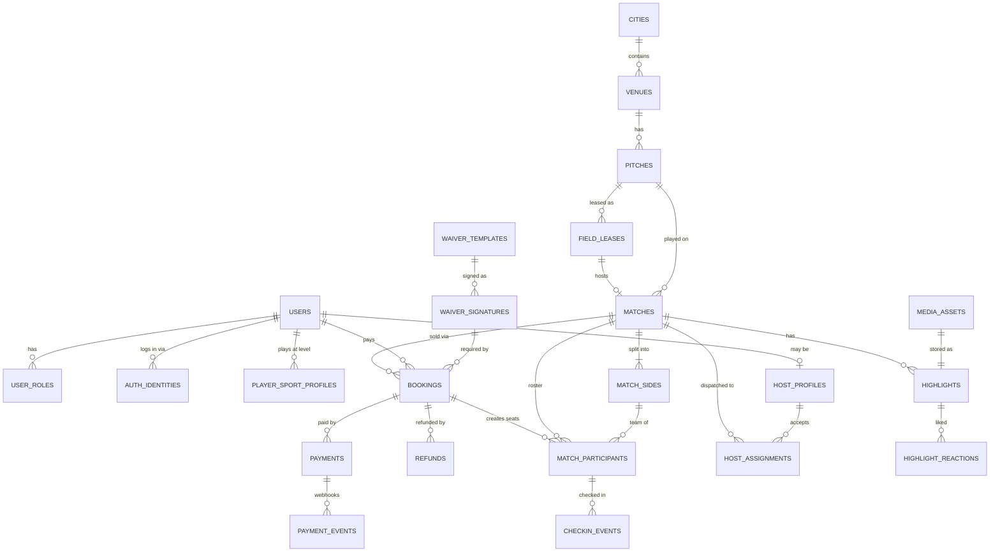
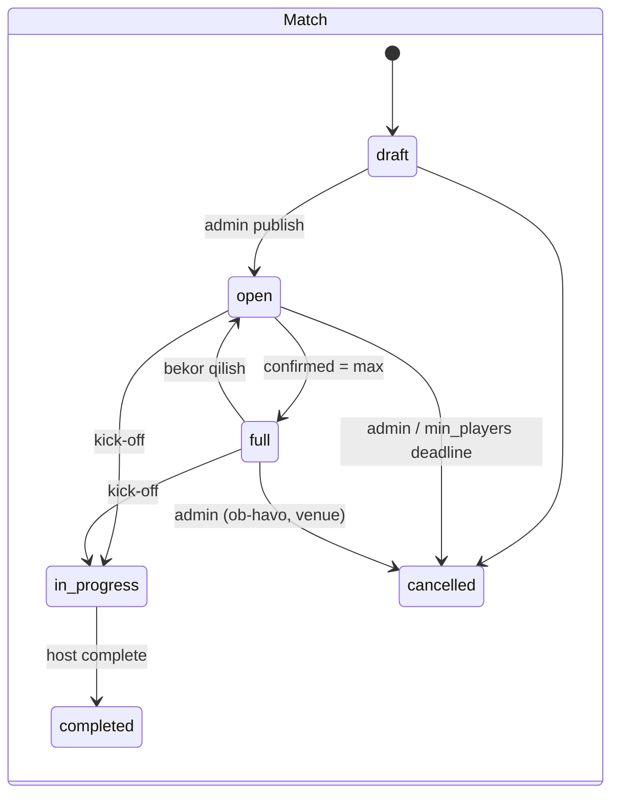
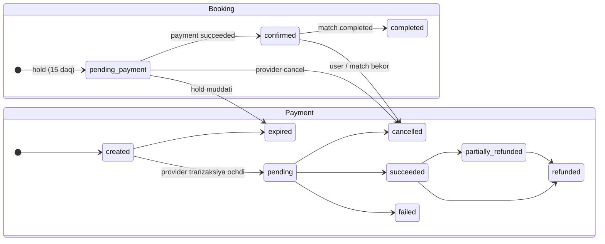
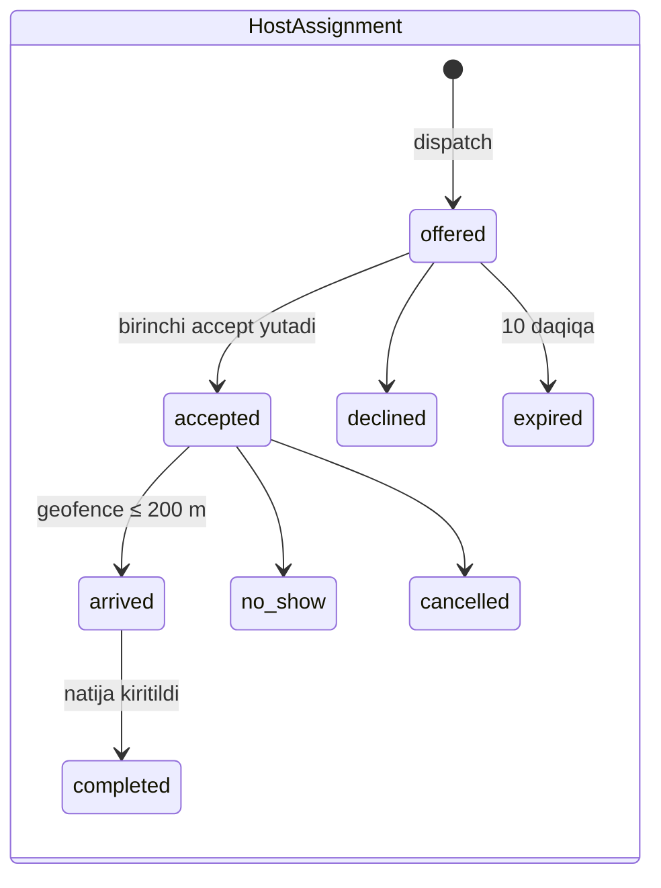
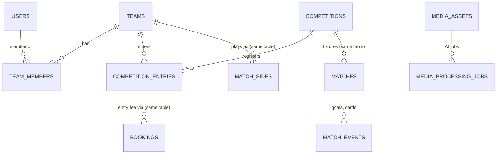
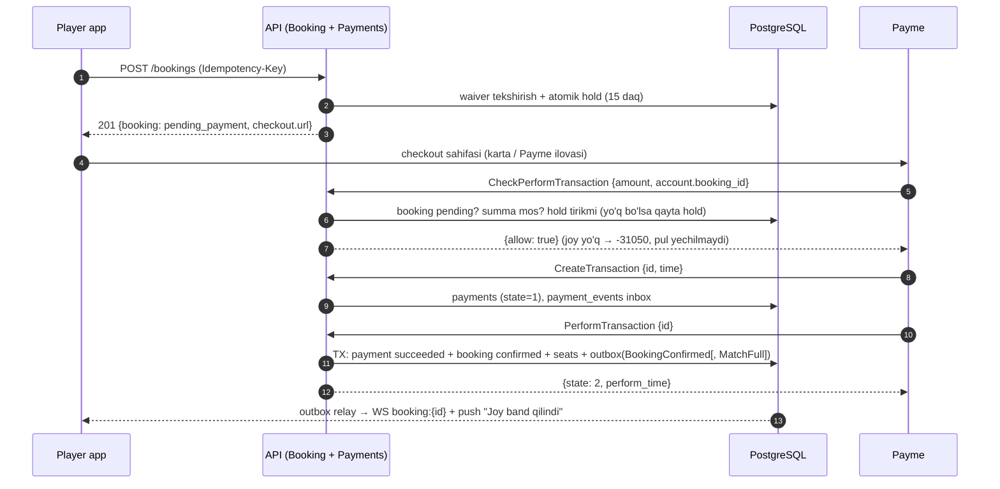
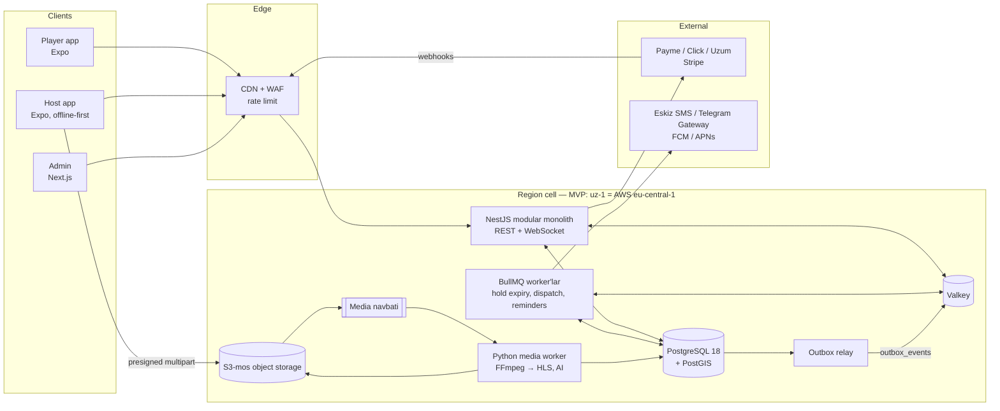

# Match Up — Texnik arxitektura

> Pickup sports platformasi: admin maydon slotini ijaraga oladi → match yaratadi → o'yinchilar bittadan joy sotib oladi → match to'lganda freelance **Match Host** chaqiriladi → host check-in qiladi, o'yinni boshqaradi, highlight yozadi.
> Birinchi bozor: **O'zbekiston** (UZS, Payme / Click / Uzum). Keyin xalqaro (Stripe, Apple Pay, PayPal) va Super App (Teams, Leagues, Tournaments, AI highlight).

| Artefakt | Fayl | Holat |
|---|---|---|
| MVP DB sxemasi | [`db/migrations/0001_core_mvp.sql`](../db/migrations/0001_core_mvp.sql) | PostgreSQL 18 + PostGIS 3.6'da tekshirilgan |
| Phase 2 migratsiyasi | [`db/migrations/0002_phase2_competitions.sql`](../db/migrations/0002_phase2_competitions.sql) | Mavjud ma'lumotlar ustiga tekshirilgan |
| Kritik query'lar | [`db/queries/`](../db/queries/) | discovery, hold, confirm, expire, cancel, dispatch |
| Avtomatik tekshiruv | [`db/tests/verify.sh`](../db/tests/verify.sh) | oversell race, constraint'lar, Phase 2 |
| API kontrakti | [`api/openapi.yaml`](../api/openapi.yaml) | OpenAPI 3.1, 45 ta operation, Redocly lint toza |

---

## 0. Asosiy qarorlar (qisqacha)

| # | Qaror | Nima uchun |
|---|---|---|
| 1 | **React Native (Expo) + NestJS — hammasi TypeScript** | Bitta til: tiplar, validatsiya (zod) va API client mobile ↔ backend o'rtasida umumiy. Kichik jamoa uchun eng tez MVP. |
| 2 | **Modular monolith**, microservice emas | 3–6 dasturchili jamoaga microservice'lar operatsion yuk. Modul chegaralari + outbox event'lar keyinroq ajratishni arzon qiladi. |
| 3 | **Video/AI — alohida Python servisi** birinchi kundan | FFmpeg/PyTorch ekotizimi Python'da; og'ir CPU/GPU ishi API latency'siga ta'sir qilmasligi kerak. |
| 4 | **PostgreSQL + PostGIS** yagona haqiqat manbai | Pul va joylar uchun ACID; oversell, ikki marta ijara, ikki marta to'lov DB constraint'lari bilan imkonsiz. |
| 5 | **Joy band qilish = atomik shartli UPDATE** (Redis lock emas) | 30 parallel so'rovda 14 joyga aniq 14 booking — test bilan isbotlangan. Bitta komponent kam = bitta nosozlik nuqtasi kam. |
| 6 | **MVP — bitta Hetzner server (Docker Compose), o'sish — managed AWS (Frankfurt); dizayn — cell-based** | 2026-yil mart o'zgarishidan keyin UZ foydalanuvchilarining (biometrikdan tashqari) ma'lumotlarini adekvat davlatda saqlash mumkin; Finlyandiya va Germaniya ro'yxatda. Pilot uchun bitta server arzon va sodda; yuk o'sganda AWS (Terraform tayyor). Cell pattern boshqa davlatlarning lokalizatsiya talablari uchun saqlanadi (§4.3, [DEPLOYMENT.md](DEPLOYMENT.md) §10). |
| 7 | **Payment adapter pattern** | Payme/Click/Uzum (merchant-API) va Stripe (async webhook) bitta ichki state machine'ga normalizatsiya. |
| 8 | **Roster ≠ to'lov** (`match_participants` ≠ `bookings`) | Mehmonlar, admin taklifi, walk-in va Phase 2 jamoa roster'i — hammasi bitta check-in oqimidan o'tadi. |

---

## 1. Tech stack

### 1.1 Mobile: React Native vs Flutter

| Mezon | React Native (Expo, TS) | Flutter (Dart) |
|---|---|---|
| Backend bilan kod ulashish | ✅ tiplar, zod sxemalar, OpenAPI'dan generatsiya qilingan client | ❌ alohida til, alohida modellar |
| OTA hotfix (store review'siz) | ✅ EAS Update | ⚠️ rasmiy yechim yo'q (Shorebird — 3rd party) |
| QR skaner + video yozish | ✅ `react-native-vision-camera` (code scanner + recording) | ✅ `camera`, `mobile_scanner` |
| Performance | ✅ New Architecture (Fabric/JSI) — bu ilova uchun yetarli (ro'yxat, xarita, forma) | ✅ biroz yaxshiroq animatsiya |
| O'zbekistonda yollash | ✅ JS/TS dasturchilar ko'p | ⚠️ kamroq |
| Admin panel bilan umumiy | ✅ React (Next.js) | ❌ |

**Tanlov: React Native + Expo (TypeScript).** Ikki app bitta monorepoda:

- **Player app** — discovery, booking, to'lov, chipta, highlight feed.
- **Host app** — offer'lar, offline roster, QR check-in, geofence, video yozish/yuklash. Alohida app, chunki kamera, background location va offline storage ruxsatlari player'ga kerak emas (App Store/Play review shuni so'raydi) va host oqimi butunlay boshqa.

### 1.2 Backend: Node.js (NestJS) vs Python (FastAPI)

| Mezon | NestJS (TS) | FastAPI (Python) |
|---|---|---|
| Mobile/admin bilan bitta til | ✅ | ❌ |
| Modul chegaralari, DI, guard'lar | ✅ framework'ning asosi | ⚠️ qo'lda tuziladi |
| I/O-heavy API (booking, webhook, WebSocket) | ✅ event loop'ga mos | ✅ async |
| Video / ML / AI | ❌ zaif ekotizim | ✅ FFmpeg, PyTorch, OpenCV |

**Tanlov: ikkalasi, har biri o'z joyida.**
- **Core API — NestJS (Node 22 LTS)** + **Drizzle ORM** (SQL-first: PostGIS, `FOR UPDATE`, partial index, CTE'larni yashirmaydi). Migratsiyalar — toza SQL fayllar (`db/migrations`).
- **Media worker'lar — Python** (FastAPI faqat health/admin endpointlari uchun; asosiy ish — navbatdan job olish). Core bilan faqat navbat (SQS / Redis Streams) va object storage orqali gaplashadi.

### 1.3 Ma'lumotlar, kesh, real-time

| Qatlam | Tanlov | Vazifasi |
|---|---|---|
| Asosiy DB | **PostgreSQL 18 + PostGIS 3.6** | Barcha biznes ma'lumotlar. Native `uuidv7()`, `EXCLUDE` constraint, composite GiST (geo + vaqt). |
| Kesh / navbat / rate-limit | **Valkey (Redis-mos)** + **BullMQ** | OTP challenge'lar (TTL), rate limit, discovery keshi, delayed job'lar (hold expiry, dispatch timeout, eslatmalar). |
| Real-time | **Socket.IO** (NestJS gateway + Redis adapter) | `match:{id}` → bo'sh joylar soni; `booking:{id}` → to'lov holati; host'ga offer'lar. |
| Push / SMS / OTP | Expo Push (FCM/APNs), **Eskiz.uz** SMS, **Telegram Gateway API** | O'zbekistonda Telegram orqali OTP SMS'dan arzon va ishonchli; SMS — zaxira. |
| Object storage | **Hetzner Object Storage** (MVP, server bilan bir location) -> AWS S3 + CloudFront (o'sish); biometrik ma'lumot paydo bo'lsa — O'zbekiston ichidagi S3-mos storage | S3 API standart — kod o'zgarmasdan boshqa storage'ga ko'chiriladi. |
| Qidiruv | PostGIS (MVP) → OpenSearch (faqat full-text/feed kerak bo'lganda) | MVP'da alohida qidiruv klasteri keraksiz. |
| Observability | OpenTelemetry → Grafana (Prometheus, Loki, Tempo), Sentry, PostHog (EU Cloud) | Analytics ham shaxsiy ma'lumot — adekvat ro'yxatdagi davlatda (EU) saqlanadi. |

### 1.4 Monorepo tuzilmasi

```
matchup/
├── apps/
│   ├── api/            # NestJS modular monolith
│   ├── player/         # Expo (React Native) — o'yinchi app
│   ├── host/           # Expo — host app (offline-first)
│   └── admin/          # Next.js (App Router) + TanStack Query/Table — ichki panel, BFF (httpOnly cookie)
├── services/
│   └── media-worker/   # Python: FFmpeg transcode, keyin AI highlight
├── packages/
│   ├── contracts/      # openapi.yaml → generatsiya qilingan TS client + zod
│   ├── ui/             # umumiy dizayn tizimi: sof TS tokenlar (/tokens, web ham) + RN komponentlar
│   └── i18n/           # tarjima kalitlari (uz-Latn, uz-Cyrl, ru, en)
├── db/                 # SQL migratsiyalar, seed, query'lar, testlar
└── infra/              # Terraform + Helm (har cell uchun)
```

pnpm workspaces + Turborepo. API kontrakti o'zgarsa — client bitta PR'da qayta generatsiya qilinadi, CI tiplar mos kelmasa yiqiladi.

---

## 2. Ma'lumotlar bazasi

### 2.1 Konvensiyalar

| Mavzu | Qoida |
|---|---|
| Primary key | `uuid DEFAULT uuidv7()` — vaqt bo'yicha tartiblangan (B-tree'ga do'st, ID'dan yaratilish vaqti ko'rinadi, taxmin qilib bo'lmaydi). Reference jadvallar: `smallint`/`integer` identity. |
| Pul | `bigint` **minor units** + `char(3)` valyuta. UZS → tiyin (Payme ham tiyin'da ishlaydi). Hech qachon `float`/`numeric` emas. |
| Vaqt | `timestamptz` (UTC). Ko'rsatish — venue `timezone` bo'yicha, qurilma vaqt zonasi bo'yicha emas. |
| Tarjima | `jsonb`: `{"uz-Latn": "...", "uz-Cyrl": "...", "ru": "...", "en": "..."}`. O'qish: `coalesce(title->>$locale, title->>'uz-Latn')`. |
| Status | Postgres `ENUM` (tartibli: `skill_level` uchun `<`/`>` ishlaydi). |
| Invariantlar | App kodida emas, **DB constraint**'larida: CHECK, partial UNIQUE, EXCLUDE, FK. App xatoni Problem `code`'ga o'giradi. |
| Append-only | `waiver_signatures`, `consents`, `checkin_events`, `wallet_transactions`, `audit_logs` — UPDATE/DELETE trigger bilan bloklangan. |
| Modul egaligi | Har jadval bitta NestJS moduliga tegishli; boshqa modullar unga faqat o'sha modulning service'i orqali yozadi. |

### 2.2 ER diagramma (MVP yadrosi)



### 2.3 Jadvallar ma'lumotnomasi (MVP — 47 jadval)

| Modul | Jadval | PK | Asosiy FK / constraint | Vazifa |
|---|---|---|---|---|
| Reference | `currencies` | `code char(3)` | — | `minor_unit` (UZS=2) |
| | `countries` | `code char(2)` | → currencies | `data_region` (qaysi cell), default locale |
| | `cities` | `id int` | → countries, currencies | IANA `timezone`, `center geography` |
| | `sports` | `id smallint` | `code` UNIQUE | default jamoa hajmi |
| | `fx_rates` | (base, quote, as_of) | → currencies | faqat hisobot |
| Identity | `users` | uuid | → countries, cities, media_assets | `phone_e164` UNIQUE, `data_region`, soft delete + `anonymized_at` |
| | `user_roles` | (user_id, role) | → users | M:N: player + host + admin |
| | `auth_identities` | uuid | UNIQUE (provider, provider_uid) | phone / google / apple / telegram |
| | `user_sessions` | uuid | `refresh_token_hash` UNIQUE, `family_id` | rotation + reuse detection |
| | `device_tokens` | uuid | `push_token` UNIQUE | push, locale |
| Profile | `player_sport_profiles` | (user_id, sport_id) | → users, sports | self_level, Glicko-2 `rating` / `rating_deviation` / `rating_volatility`, no_show_count |
| | `player_rating_changes` | (match_id, user_id) | → matches, users | har match bo'yicha reyting o'zgarishi: tarix + idempotentlik |
| Catalog | `venues` | uuid | → cities; GiST(location) | stadion, partner kontakti |
| | `amenities`, `venue_amenities` | id / (venue, amenity) | | filtr: parking, shower... |
| | `pitches`, `pitch_sports` | uuid / (pitch, sport) | UNIQUE (venue_id, name) | maydon: sirt, indoor, o'lcham |
| | `field_leases` | uuid | → pitches; **EXCLUDE (pitch_id =, period &&)** | ijara, `cost_amount` (unit economics) |
| Matches | `cancellation_policies` | smallint | `rules jsonb` | refund qoidalari |
| | `waiver_templates` | uuid | UNIQUE (code, version, locale) | matn o'zgarmas, `body_sha256` trigger |
| | `matches` | uuid | → sports, pitches, field_leases, cities; **CHECK held+confirmed ≤ max**; GiST (location, starts_at) | narx, sig'im, status, deadline'lar |
| | `match_sides` | (match_id, side_no) | → matches | Oranges/Blues, bib rangi, hisob |
| | `waiver_signatures` | uuid | → users, waiver_templates; append-only | hash snapshot, IP, UA, guardian |
| | `match_participants` | uuid | → matches, bookings, users, (match, side); **partial UNIQUE (match_id, user_id)** | roster: held → confirmed → checked_in |
| | `match_waitlist` | uuid | partial UNIQUE (match, user) | navbat |
| Booking | `bookings` | uuid | → users, matches, waiver_signatures; **exclusive-arc CHECK**, summa CHECK, waiver CHECK | to'lovchi, hold `expires_at` |
| Payments | `payment_provider_configs` | smallint | UNIQUE (country, provider) | routing, `secret_ref` (secret DB'da emas) |
| | `payments` | uuid | → bookings; UNIQUE (provider, provider_transaction_id); partial UNIQUE bitta muvaffaqiyatli to'lov | `provider_state jsonb` (Payme vaqtlari) |
| | `payment_events` | uuid | **UNIQUE (provider, provider_event_id)** | webhook inbox, dedupe |
| | `refunds` | uuid | → payments, bookings | original_method / wallet |
| | `wallet_accounts`, `wallet_transactions` | uuid | balance ≥ 0; append-only ledger | tezkor refund, kredit |
| Compliance | `consents` | uuid | append-only; view `user_current_consents` | marketing, analytics, **media_appearance** |
| | `data_subject_requests` | uuid | `due_at = +30 kun` | GDPR export / erasure |
| | `audit_logs` | bigint | append-only | admin harakatlari |
| Host ops | `host_profiles` | user_id | → users; GiST(base_location) | kit, reyting, payout (tokenized) |
| | `host_sports` | (user, sport) | | qaysi sportlarni olib boradi |
| | `host_assignments` | uuid | **partial UNIQUE (match_id) faol statuslar** | offer → accept → arrive → complete |
| | `checkin_events` | uuid | `client_event_id` UNIQUE; append-only | offline sync, GPS |
| | `host_payouts` | uuid | UNIQUE (host, period) | davriy to'lov |
| | `match_feedback` | uuid | UNIQUE NULLS NOT DISTINCT | host/o'yinchi/venue reytingi |
| Media | `media_assets` | uuid | UNIQUE (bucket, object_key) | `storage_region`, multipart `upload_id` |
| | `highlights` | uuid | → matches, media_assets (1:1) | offset, visibility, moderatsiya, counter'lar |
| | `highlight_tags`, `highlight_reactions`, `highlight_shares` | composite / uuid | | teg (consent bilan), like, share |
| Platform | `notifications` | uuid | | yuborilgan xabarlar tarixi |
| | `outbox_events` | uuid | partial index unpublished | transactional outbox |

To'liq DDL (har bir ustun, tip, default, index): [`0001_core_mvp.sql`](../db/migrations/0001_core_mvp.sql).

### 2.4 Kritik mexanizmlar

#### a) Oversell'ning oldini olish — atomik seat hold

```sql
WITH hold AS (
  UPDATE matches
     SET held_slots = held_slots + :seats
   WHERE id = :match_id
     AND status = 'open'
     AND now() < booking_closes_at
     AND held_slots + confirmed_slots + :seats <= max_players     -- shart row lock ostida qayta tekshiriladi
  RETURNING id, price_amount, currency
), b AS (
  INSERT INTO bookings (..., expires_at) SELECT ..., now() + interval '15 minutes' FROM hold
  RETURNING id, match_id, user_id
)
INSERT INTO match_participants (match_id, booking_id, user_id, status) SELECT match_id, id, user_id, 'held' FROM b;
```

- READ COMMITTED'da parallel UPDATE'lar `matches` qatorida navbatga turadi; har biri WHERE'ni **yangi** qiymat bilan qayta baholaydi (EvalPlanQual). Natija: 0 qator → `409 MATCH_FULL`.
- Ikkinchi himoya: `CHECK (held_slots + confirmed_slots <= max_players)`.
- Bitta odam ikki marta yozilsa — partial UNIQUE index → butun statement rollback → `409 ALREADY_BOOKED`.
- **Isbot:** `verify.sh` 30 ta parallel client'ni 14 joyli match'ga yuboradi → aniq 14 booking, 14 roster qatori; ikkinchi to'lqinda 3 bo'sh joyga aniq 3 ta.
- Hot row: bitta match'ga daqiqasiga yuzlab so'rov bo'lmaydi (max 14–22 joy), shuning uchun bitta qator lock'i muammo emas. Redis lock qo'shish faqat yangi nosozlik nuqtasi bo'lardi.

#### b) Hold → to'lov → tasdiqlash / muddat o'tishi

| Hodisa | Query | Natija |
|---|---|---|
| To'lov muvaffaqiyatli | [`confirm_payment.sql`](../db/queries/confirm_payment.sql) | `held → confirmed`, `confirmed_slots == max` bo'lsa `status = full` + `MatchFull` outbox event |
| Takroriy webhook | o'sha query | `status IN ('created','pending')` sharti → 0 qator, holat o'zgarmaydi (idempotent, test qilingan) |
| 15 daqiqa o'tdi | [`expire_holds.sql`](../db/queries/expire_holds.sql) (BullMQ, har 30 s) | `expired`, joylar qaytadi, `SlotsReleased` → waitlist |
| Sweeper va webhook poygasi | ikkalasi `WHERE status = 'pending_payment'` | faqat bittasi yutadi; webhook yutqazsa → "late payment" yo'li |
| O'yinchi bekor qildi | [`cancel_booking.sql`](../db/queries/cancel_booking.sql) | joy qaytadi, `full → open`, refund policy bo'yicha |

**Late payment** (pul yechildi, lekin hold allaqachon o'tgan): joy bo'lsa qayta hold + confirm; bo'lmasa avtomatik refund (wallet'ga darhol yoki kartaga) + push. Payme/Click/Uzum'da bu deyarli bo'lmaydi — ular pul yechishdan **oldin** bizdan so'raydi (`CheckPerformTransaction` / `Prepare`), va biz shu yerda hold'ni qayta tekshiramiz. Rahmat (Multicard) callback'i pul yechilgandan keyin keladi, lekin `success: false` javobida Multicard to'lovni o'zi bekor qilib pulni qaytaradi; callback yo'qolib, holat so'rovi to'langanini ko'rsatsa va joy qolmagan bo'lsa — to'liq refund navbatga (§4.6).

#### c) Ikki marta ijaraga olishning oldini olish

```sql
CONSTRAINT field_leases_no_overlap EXCLUDE USING gist (pitch_id WITH =, period WITH &&)
  WHERE (status <> 'cancelled')
```
`[19:00, 20:30)` va `[20:30, 22:00)` — ruxsat (tutash), `[19:30, 21:00)` — rad etiladi. Ikkalasi testda tekshirilgan.

#### d) Roster to'lovdan alohida

`bookings` — **kim to'ladi** (1 ta checkout, 1–4 joy). `match_participants` — **kim o'ynaydi** (har joy uchun bitta qator: o'zi, mehmon `guest_name` bilan, admin taklifi, host walk-in, Phase 2'da jamoa a'zosi). Check-in, no-show statistikasi, jamoalarga bo'lish, reyting — hammasi roster ustida ishlaydi va to'lov turidan bexabar.

#### e) Compliance DB darajasida

- `bookings_waiver_required`: imzosiz match booking'i **yaratib bo'lmaydi** (app'dagi bug ham buni chetlab o'ta olmaydi).
- `waiver_templates` matni o'zgarmas — o'zgartirish faqat yangi `version` orqali; imzoda `document_sha256` snapshot.
- `consents` append-only — "foydalanuvchi qachon nimaga rozi bo'lgan" tarixi yo'qolmaydi.

### 2.5 State machine'lar







Har bir o'tish — bitta servis metodi, bitta tranzaksiya, bitta outbox event. Ruxsat etilmagan o'tish → `409 Conflict`.

### 2.6 Phase 2: Teams, Leagues, Tournaments — core'ni qayta yozmasdan

[`0002_phase2_competitions.sql`](../db/migrations/0002_phase2_competitions.sql) **faqat qo'shadi**:



| Phase 2 ehtiyoji | Qanday yechiladi | Core'dagi o'zgarish |
|---|---|---|
| Liga o'yini | oddiy `matches` qatori + `competition_id`, `round_label` | 2 ta nullable ustun |
| Jamoa vs jamoa | `match_sides.team_id` | 1 ta nullable ustun |
| Jamoa ro'yxatdan o'tish to'lovi | `bookings.bookable_type = 'competition_entry'` | enum qiymati + ustun + CHECK almashtirish |
| Jamoa a'zolari check-in | `match_participants.source = 'team_roster'` | enum qiymati |
| Statistika, AI timestamp | yangi `match_events` | — |
| Turnir jadvali | `competition_standings` view | — |

Checkout servisi `Bookable` interfeysi orqali ishlaydi — yangi tur = yangi strategiya klassi, booking/payment kodi tegilmaydi:

```ts
interface Bookable {
  readonly type: 'match_slot' | 'competition_entry';
  quote(ctx: QuoteCtx): Promise<{ unitPrice: Money; seats: number; waiverRequired: boolean }>;
  hold(tx: Tx, booking: NewBooking): Promise<void>;     // match: atomik seat hold; entry: entry status
  confirm(tx: Tx, bookingId: string): Promise<void>;
  release(tx: Tx, bookingId: string, reason: ReleaseReason): Promise<void>;
}
```

**Tekshirilgan:** `0002` seed ma'lumotlari ustiga qo'llandi → mavjud booking'larning md5 hash'i o'zgarmadi; `competition_entry` booking + payment o'sha jadvallarda yaratildi; exclusive-arc noto'g'ri kombinatsiyani rad etdi; standings view g'olibga 3 ochko berdi.

### 2.7 Index va masshtab

| Query | Index | O'lchov |
|---|---|---|
| Discovery (geo + vaqt + status) | `matches_discovery_gix` — GiST `(location, starts_at)`, partial `status IN ('open','full') AND visibility='public'` | 50 000 match'da index ishlatiladi (verify.sh tekshiradi) |
| Mening booking'larim | `bookings (user_id, created_at DESC)` | |
| Hold sweeper | `bookings (expires_at) WHERE status = 'pending_payment'` | faqat faol hold'lar indekslanadi |
| Dispatch | `host_profiles` GiST `(base_location) WHERE status = 'active'` | |
| Webhook dedupe | `payment_events UNIQUE (provider, provider_event_id)` | |

Keyingi bosqichlar (faqat metrikalar talab qilganda): read replica (discovery, feed) → `audit_logs`, `checkin_events`, `notifications`, `payment_events` oylik partition → eski partition'larni arxivga.

---

## 3. Core API (MVP)

To'liq kontrakt: [`api/openapi.yaml`](../api/openapi.yaml). Undan `packages/contracts` TS client'ni generatsiya qiladi.

### 3.1 Konvensiyalar

| Mavzu | Qoida |
|---|---|
| Versiya | URL'da: `/v1/...` |
| Auth | `Authorization: Bearer <JWT>` — EdDSA, access 15 daq; refresh token rotation, eski token qayta ishlatilsa butun `family_id` bekor |
| Xatolar | RFC 9457 `application/problem+json` + `code` (`MATCH_FULL`, `ALREADY_BOOKED`, `WAIVER_REQUIRED`, `OUTSIDE_GEOFENCE`...) |
| Pul | `{"amount": 4500000, "currency": "UZS", "formatted": "45 000 so'm"}` |
| Idempotency | `Idempotency-Key` (UUID) — `POST /bookings`, `/cancel`, admin bekor qilish; 24 soat Redis + `bookings UNIQUE (user_id, idempotency_key)` |
| Pagination | `cursor` + `limit` → `next_cursor` (keyset: `(starts_at, id)`) |
| Til | `Accept-Language` → `user.locale` → shahar default |
| Rate limit | OTP: telefon 1/60s, 5/soat; IP 20/soat. Umumiy: user 300/daq |

### 3.2 Endpointlar

**Auth & profil**

| Method | Path | Request | Response |
|---|---|---|---|
| POST | `/v1/auth/otp/request` | `{phone, channel: sms\|telegram}` | `{challenge_id, expires_in, resend_after}` |
| POST | `/v1/auth/otp/verify` | `{challenge_id, code, device}` | `{access_token, refresh_token, expires_in, user, is_new_user}` |
| POST | `/v1/auth/social` | `{provider: google\|apple\|telegram, id_token + nonce? \| telegram_auth, device}` | o'sha |
| GET | `/v1/auth/telegram/start?redirect_uri=` | — | 302 → oauth.telegram.org (brauzer orqali Telegram Login) |
| POST | `/v1/auth/refresh` | `{refresh_token}` | yangi token juftligi |
| POST | `/v1/auth/logout` | — | 204 |
| GET / PATCH | `/v1/me` | `{display_name, locale, home_city_id, birth_date, gender}` | `User` |
| PUT | `/v1/me/sports/{sport}` | `{self_level, preferred_position}` | `SportProfile` |
| PUT | `/v1/me/consents` | `{consents: [{purpose, granted, document_version}]}` | joriy holat |
| GET / POST | `/v1/me/identities` | `SocialCredential` | kirish usullari ro'yxati |
| DELETE | `/v1/me/identities/{google\|apple\|telegram}` | — | 204 (oxirgi usul — 409) |
| POST | `/v1/me/data-export` | — | 202 `DataSubjectRequest` |
| GET | `/v1/me/data-requests` | — | eksport/erasure holati, bloklanish sabablari |
| GET | `/v1/me/data-exports/{id}` | — | JSON fayl (egasi, muddat ichida) |
| DELETE | `/v1/me` | — | 202 (30 kun grace → anonimlashtirish) |
| DELETE | `/v1/me/erasure-request` | — | grace davrida bekor qilish |

Onboarding: `otp/verify` → `is_new_user: true` → `PATCH /me` (ism, shahar) → `PUT /me/sports/football` → `PUT /me/consents` (terms, privacy majburiy; marketing, media_appearance ixtiyoriy).

**Discovery**

| Method | Path | Izoh |
|---|---|---|
| GET | `/v1/matches?lat&lng&radius_km&sport&date_from&date_to&min_slots&price_max&level&sort&cursor&limit` | [`discovery.sql`](../db/queries/discovery.sql) |
| GET | `/v1/matches/{id}` | roster preview (faqat ism/avatar), waiver holati, `my_booking` |
| POST / DELETE | `/v1/matches/{id}/waitlist` | to'la match uchun navbat |
| GET / POST | `/v1/matches/{id}/feedback` | o'yindan keyin baholash (host, o'yinchilar, o'yin, maydon; 1–5): faqat kelgan o'yinchi, 7 kun ichida; host baholari → `host_profiles.rating_avg`; GDPR erasure'da izohlar (`comment`) o'chiriladi, baholar qoladi |
| GET | `/v1/venues/{id}`, `/v1/sports`, `/v1/cities` | CDN keshlanadi |
| WS | `match:{id}` → `slots.updated` | live bo'sh joylar |

```json
GET /v1/matches?lat=41.2995&lng=69.2401&radius_km=15&sport=football&min_slots=1
{
  "items": [{
    "id": "01a14af9-734c-7ed5-a7de-75db4109f156",
    "public_code": "MU-RACE",
    "sport": "football",
    "format": "7v7",
    "starts_at": "2026-10-18T14:00:00Z",
    "ends_at": "2026-10-18T15:30:00Z",
    "timezone": "Asia/Tashkent",
    "price": { "amount": 4500000, "currency": "UZS", "formatted": "45 000 so'm" },
    "slots": { "max": 14, "min_to_play": 10, "taken": 13, "available": 1 },
    "status": "open",
    "host_assigned": false,
    "venue": { "id": "…", "name": "Chilonzor Arena", "distance_m": 4062,
               "location": { "lat": 41.2756, "lng": 69.2034 } }
  }],
  "next_cursor": "MjAyNi0xMC0xOFQxNDowMDowMFp8MDFhMTRhZjk…"
}
```

**Booking & to'lov**

| Method | Path | Izoh |
|---|---|---|
| GET | `/v1/waivers/required?match_id` | user tilidagi oxirgi versiya + `signed` |
| POST | `/v1/waivers/{template_id}/signatures` | `{accepted, method, document_sha256, guardian?}` |
| GET | `/v1/payment-methods?match_id` | priority bo'yicha + wallet balansi |
| POST | `/v1/bookings` | hold + checkout (pastda) |
| GET | `/v1/bookings/{id}` | to'lovdan qaytgach polling (yoki WS `booking:{id}`) |
| POST | `/v1/bookings/{id}/cancel` | policy bo'yicha refund natijasi |
| GET | `/v1/bookings/{id}/ticket` | Ed25519 imzolangan QR payload |
| GET | `/v1/me/bookings?scope=upcoming\|past` | |
| POST | `/v1/webhooks/payme` | JSON-RPC: `CheckPerformTransaction`, `CreateTransaction`, `PerformTransaction`, `CancelTransaction`, `CheckTransaction`, `GetStatement` |
| POST | `/v1/webhooks/click/prepare`, `/complete` | form-urlencoded, MD5 `sign_string` |
| POST | `/v1/webhooks/uzum/{check\|create\|confirm\|reverse\|status}` | Uzum Merchant API: Basic auth, JSON, tiyin; xato — HTTP 400 + `errorCode` |
| POST | `/v1/webhooks/multicard` | Rahmat (Multicard) callback'i: `md5(store_id + invoice_id + amount + secret)`, `{success}` javob (§4.6) |
| POST | `/v1/webhooks/stripe` | `Stripe-Signature` |

```json
POST /v1/bookings            Idempotency-Key: 8b1f…
{ "match_id": "01a1…", "seats": 1, "payment_method": "payme",
  "use_wallet": false, "waiver_signature_id": "01a1…", "return_url": "matchup://bookings/return" }

201 Created
{ "booking":  { "id": "01a1…", "status": "pending_payment", "expires_at": "2026-10-18T09:15:00Z",
                "total": { "amount": 4500000, "currency": "UZS", "formatted": "45 000 so'm" } },
  "checkout": { "type": "redirect", "provider": "payme",
                "url": "https://checkout.paycom.uz/<base64(m=…;ac.booking_id=…;a=4500000;c=…)>" } }
```

Stripe uchun `checkout = {type: "sdk", client_secret, publishable_key, ephemeral_key}` (Payment Sheet + Apple Pay / Google Pay); wallet to'liq yopsa `{type: "none"}` va booking darhol `confirmed`.



**Host panel**

| Method | Path | Izoh |
|---|---|---|
| GET | `/v1/host/offers` | dispatch offer'lari (fee, masofa, muddat) |
| POST | `/v1/host/offers/{id}/accept` \| `/decline` | birinchi accept yutadi; `409 OFFER_TAKEN` |
| GET | `/v1/host/matches?scope=today\|upcoming\|past` | |
| GET | `/v1/host/matches/{id}/roster` | to'liq roster + `qr_public_key` + `roster_version` (offline kesh) |
| POST | `/v1/host/matches/{id}/arrive` | `{location, accuracy_m}` → geofence ≤ 200 m |
| POST | `/v1/host/matches/{id}/checkins` | batch, offline sync, `client_event_id` bilan idempotent |
| PATCH | `/v1/host/matches/{id}/participants/{pid}` | `{side_no}`, `{bib_number}` (AI-Cam, `409 BIB_TAKEN`) yoki `{status: no_show}` |
| POST | `/v1/host/matches/{id}/complete` | `{scores, mvp_participant_id, incidents}` |
| POST | `/v1/host/matches/{id}/highlights/uploads` | S3 multipart presigned URL'lar (≤ 60 s, ≤ 150 MB, mp4/mov); faqat tayinlangan host |
| GET | `/v1/host/matches/{id}/highlights` | shu match kliplari (qayta ishlanayotgan / xato berganlari bilan) |
| GET / PUT | `/v1/host/matches/{id}/recording[/cameras/{clientCameraId}]` | AI-Cam A: to'liq o'yin yozuvi — sessiya / kamera faylini ro'yxatga olish (idempotent, oflayn'dan keyin ham) |
| POST | `/v1/host/matches/{id}/recording/cameras/{clientCameraId}/upload` | yozuv fayli multipart (≤ 40 GB, ≤ 3 soat, qism 16 MiB) — keyin oddiy `/v1/media/{id}/…` |
| POST / DELETE | `/v1/host/matches/{id}/recording/markers[/{clientMarkerId}]` | "Highlight!" / "Kick-off" belgilari — kamera tayyor bo'lgach klip avtomatik kesiladi ([`AI_CAM.md`](AI_CAM.md) §12) |
| GET / DELETE | `/v1/media/{id}/upload` | davom ettirish: yuklangan qismlar + keyingi (100 tagacha) qismlar uchun yangi URL'lar / bekor qilish |
| POST | `/v1/media/{id}/complete` | `CompleteMultipartUpload` → highlight (+ teglar) yoki yozuv kamerasi → transcode navbati (idempotent; `parts` siz — ETag'lar `ListParts` dan) |
| GET | `/v1/media/{id}` | yuklash va qayta ishlash holati (egasi) |

**Highlight'lar (player)**

| Method | Path | Izoh |
|---|---|---|
| GET | `/v1/matches/{id}/highlights` | faqat ishtirokchilar (`confirmed`, `checked_in`), tayinlangan host, admin |
| GET | `/v1/me/highlights?scope=all\|tagged` | profil feed'i (cursor) |
| GET | `/v1/highlights/{id}` | yangi imzolangan ijro URL'lari bilan |
| PUT / DELETE | `/v1/highlights/{id}/like` | idempotent, `likes_count` bilan bir tranzaksiyada |
| POST | `/v1/highlights/{id}/share` | `highlight_shares` + imzolangan ochiq havola `/h/{token}` (7 kun) |
| GET | `/v1/matches/{id}/recording` | to'liq o'yin videosi (faqat ishtirokchilar, host, admin): kameralar HLS bilan, belgilangan lahzalar har kameradagi vaqti bilan |
| GET | `/v1/playback/{token}/{master\|1080p\|720p\|480p}.m3u8` | HLS playlist'lar (token URL'da) — klip va yozuv kameralari; segmentlar — imzolangan CDN/S3 URL |
| POST | `/internal/media/jobs/{id}/start\|progress\|result` | faqat media worker (servis token, VPC ichida) |

```json
POST /v1/host/matches/01a1…/checkins
{ "events": [
  { "client_event_id": "0f6c…", "action": "check_in", "method": "qr",
    "qr_payload": "mu1.eyJwIjoi…", "occurred_at": "2026-10-18T13:52:11Z",
    "location": { "lat": 41.2757, "lng": 69.2031 } },
  { "client_event_id": "1a2b…", "action": "check_in", "method": "manual",
    "participant_id": "01a1…", "occurred_at": "2026-10-18T13:53:40Z" } ] }

200 OK
{ "results": [
  { "client_event_id": "0f6c…", "status": "accepted",  "participant_id": "01a1…" },
  { "client_event_id": "1a2b…", "status": "duplicate", "participant_id": "01a1…" } ],
  "roster_version": 7 }
```

**QR check-in xavfsizligi:** chipta `{participant_id, match_id, exp}` — server private key bilan **Ed25519** imzolanadi. Host app roster bilan birga public key'ni oladi → stadionda internet bo'lmasa ham imzoni tekshiradi va check-in'ni lokal yozadi, keyin batch yuboradi. Skrinshot bilan kirish: chipta faqat o'sha match uchun, roster'da `checked_in` bo'lgach ikkinchi skan `duplicate`.

**Admin:** `POST /v1/admin/matches` (lease bilan birga, ustma-ust lease → `409 LEASE_OVERLAP`), `POST /v1/admin/matches/{id}/publish`, `POST /v1/admin/matches/{id}/cancel` (barcha booking'larga 100% refund, ixtiyoriy wallet bonus). Ichki panel uchun: venue/pitch katalogi (`/venues`, `/pitches`), match jadvali va tafsiloti (roster, booking, to'lov, refund, host, audit), host'lar (telefon bo'yicha host qilish, tasdiqlash, suspend), to'lovlar, refund navbati (to'liq `original_method` refund'lari Payme / Click orqali avtomatik — §4.6; admin hal qiladiganlari `auto_status=manual`: provider kabinetida qaytarib → `POST /v1/admin/refunds/{id}/complete` `provider_refund_id` bilan, `payments.refunded_amount` yangilanadi; yoki `…/to-wallet` — o'yinchi hamyoniga; yoki `…/retry` — avto-refund'ga qaytarish), reconciliation (`GET/POST /v1/admin/finance/reconciliation`, `GET …/{runId}` — §4.6), highlight moderatsiyasi (`GET /v1/admin/highlights`, `POST …/{id}/moderate` — §4.10), dashboard (match'lar, to'lish, GMV, ijara, host to'lovlari, yalpi marja, no-show, bekor qilishlar). Jadvallar offset pagination (`limit`, `offset` → `total`). Har bir mutatsiya `audit_logs` ga (ip, request_id bilan) yoziladi.

---

## 4. Global masshtab va modular arxitektura

### 4.1 Tizim ko'rinishi



### 4.2 Modullar (bounded context'lar)

| Modul | Jadvallar | Chiqaradigan event'lar | Ajratish ehtimoli |
|---|---|---|---|
| Identity | users, user_roles, auth_identities, user_sessions, device_tokens | `UserRegistered`, `UserErased` | past |
| Profile | player_sport_profiles, match_feedback | `RatingUpdated` | past |
| Catalog | venues, pitches, amenities, field_leases | `LeaseCreated` | past |
| Matches | matches, match_sides, match_participants, match_waitlist | `MatchPublished`, `MatchFull`, `MatchMinReached`, `MatchCancelled`, `MatchCompleted`, `SlotsReleased` | o'rta |
| Booking | bookings | `BookingHeld`, `BookingConfirmed`, `BookingCancelled`, `BookingExpired` | past (Matches bilan yaqin) |
| Payments | payments, payment_events, refunds, wallet_*, payment_provider_configs | `PaymentSucceeded`, `RefundIssued` | **o'rta** (PCI/audit izolyatsiyasi) |
| HostOps | host_profiles, host_assignments, checkin_events, host_payouts | `HostAssigned`, `HostArrived`, `PlayerCheckedIn`, `HostPayoutPaid` | o'rta |
| Media | media_assets, highlights, highlight_* | `HighlightReady` | **yuqori** (allaqachon alohida worker) |
| Notifications | notifications, push_deliveries; device_tokens (`PUT /v1/me/devices`) | — (outbox consumer: `notifications`, `realtime` group'lari) | **yuqori** (birinchi ajraladi) |
| Compliance | waiver_*, consents, data_subject_requests, audit_logs | `ConsentChanged` | past |
| Competitions (Phase 2) | teams, competitions, competition_entries, match_events | `EntryConfirmed`, `StandingsChanged` | o'rta |

**Qoidalar:**
1. Modul boshqa modulning jadvaliga **yozmaydi** — faqat uning public service interfeysini chaqiradi. ESLint `boundaries` qoidasi CI'da tekshiradi.
2. Sinxron zanjir (booking → payment → seats) — bitta tranzaksiya ichida service chaqiruvlari. Asinxron reaksiyalar (push, dispatch, analytics, reyting) — faqat **outbox event**'lar orqali.
3. Outbox: event biznes o'zgarish bilan **bir tranzaksiyada** yoziladi → relay Valkey Streams'ga (keyinchalik SQS/Kafka) chiqaradi → consumer'lar idempotent. Modulni microservice'ga ajratish = consumer'ni boshqa deploy'ga ko'chirish; event kontrakti o'zgarmaydi.

### 4.3 Hosting, data residency va multi-region

#### Huquqiy holat (2026-yil oktabr)

| Davr | Qoida |
|---|---|
| 2021-yil apreldan 2026-yil martgacha | "Shaxsga doir ma'lumotlar to'g'risida"gi qonunning 27¹-moddasi: O'zbekiston fuqarolarining **barcha** shaxsiy ma'lumotlari mamlakat hududidagi, davlat reyestrida ro'yxatdan o'tgan bazalarda saqlanishi shart edi. Talab mahalliy kompaniyalarga ham, xorijiylarga ham tegishli edi; amalda asosan xorijiy platformalarga nisbatan qo'llanilgan. |
| **2026-yil 26-martdan** (o'zgartirish qonuni, rasmiy e'lon qilingan kundan kuchga kirgan) | Majburiy lokalizatsiya faqat 3 toifaga qoldi: **biometrik**, **genetik** ma'lumotlar va **O'zbekistondagi telekom operatorlari xizmatlaridan foydalanuvchilar** ma'lumotlari. Qolgan shaxsiy ma'lumotlarni xorijda saqlash va qayta ishlash mumkin, agar quyidagilardan **biri** bajarilsa: (1) davlat adekvat himoya ro'yxatida; (2) vakolatli organ talablariga mos standart shartnoma shartlari (SCC) yoki majburiy korporativ qoidalar (BCR); (3) vakolatli organ tasdiqlagan xalqaro standartlarga rioya. |
| **2026-yil avgustdan** | Vazirlar Mahkamasi 49 ta davlat va hududdan iborat adekvat ro'yxatni tasdiqladi: Germaniya, Irlandiya, Buyuk Britaniya, Fransiya, Niderlandiya, Yaponiya, Koreya, Singapur, AQSh (gazeta.uz bo'yicha — faqat EU-US Data Privacy Framework ishtirokchilari uchun) va boshqalar. **BAA va Qozog'iston ro'yxatda yo'q.** Ro'yxatdagi davlatlarga uzatish qo'shimcha ruxsatsiz va vakolatli organni xabardor qilmasdan amalga oshiriladi. Chegaradan o'tkazishda ma'lumot sizib chiqsa — 24 soat ichida Migratsiya va personallashtirish departamentiga xabar, 72 soat ichida batafsil hisobot. |

Bazalarni **davlat reyestrida ro'yxatdan o'tkazish** (ariza/xabardor qilish tartibida) bekor qilinganini ko'rsatadigan manba topilmadi — shuning uchun bu talab hamon amalda deb hisoblaymiz.

#### Match Up uchun xulosa

| Ma'lumot | Lokalizatsiya | Qayerda saqlanadi |
|---|---|---|
| Profil, telefon, booking, to'lov tarixi, roster, check-in, consent'lar | shart emas | **Hetzner Cloud — Finlyandiya (Helsinki) yoki Germaniya**: ikkalasi ham ro'yxatda, shartsiz. AWS'ga o'tilsa — eu-central-1 (Frankfurt) |
| Highlight videolar (yuzni tanish ishlatilmasa) | odatda shart emas ⚠️ | Hetzner Object Storage (server bilan bir location); AWS'da — S3 Frankfurt |
| Yuz bo'yicha avtomatik teglash, Face ID login (Phase 2 AI) | **shart — biometrik** | O'zbekiston ichidagi alohida GPU worker + storage, yoki funksiyadan voz kechish |
| Telekom abonent ma'lumotlari (IMSI, IMEI, sessiya) | biz telekom operatori emasmiz — yig'ilmaydi | — |

⚠️ "Biometrik ma'lumot" ta'rifi oddiy video yozuvga ham tegishlimi-yo'qmi — ochiq savol (§6). Yuzni tanimasdan faqat yuzni aniqlab xiralashtirish (`face_blur`) identifikatsiya emas, lekin buni ham yurist tasdiqlashi kerak.

#### Arxitekturaga ta'siri

| | MVP — pilot (UZ foydalanuvchilari) | O'sish va keyingi cell'lar |
|---|---|---|
| Cell | `uz-1` → **bitta Hetzner server** (Finlyandiya yoki Germaniya) | `uz-1` → AWS eu-central-1 (Frankfurt); `eu-1` (EU foydalanuvchilari, GDPR), boshqa davlatlar — o'sha davlat qonuniga qarab |
| Compute | Docker Compose: api, admin, media worker'lar, Caddy (TLS) | ECS Fargate (Kubernetes'siz — DevOps yuki minimal) / EKS |
| PostgreSQL | konteyner (PostgreSQL 18 + PostGIS), kunlik `pg_dump` -> Object Storage | RDS, Multi-AZ, PITR |
| Kesh | Valkey konteyner (AOF) | ElastiCache (Valkey) |
| Object storage | Hetzner Object Storage, presigned URL (CDN'siz) | S3 + CloudFront |
| Biometrik (faqat Phase 2, agar kerak bo'lsa) | O'zbekistondagi kichik colocation: GPU worker + S3-mos storage (MinIO) | — |
| IaC | `infra/hetzner` (bootstrap.sh + compose) | Terraform, har cell uchun alohida workspace |

- **Nima o'zgardi:** avval MVP uchun O'zbekistondagi data-markaz va o'zimizning Kubernetes / CloudNativePG / MinIO stack'i tavsiya qilingan edi. 2026-yil mart o'zgarishidan keyin bu shart emas. 2026-yil oktabrda pilot uchun AWS o'rniga bitta Hetzner server tanlandi: oylik xarajat bir necha barobar kam, ikki kishilik jamoa uchun sodda (bitta compose fayl); evaziga — Multi-AZ va PITR yo'q (kunlik backup), bitta nosozlik nuqtasi. Yuk yoki ishonchlilik talabi o'sganda — AWS (Terraform va deploy workflow tayyor, [DEPLOYMENT.md](DEPLOYMENT.md) §4–§7).
- **Region tanlovi:** Hetzner — Helsinki (Finlyandiya ro'yxatda, gazeta.uz va spot.uz ro'yxatida 41-o'rin) yoki Falkenstein/Nürnberg (Germaniya); AWS'da — Frankfurt. Hammasi ro'yxatda shartsiz va GDPR yurisdiksiyasida (EU foydalanuvchilari uchun ham mos). AWS UAE (`me-central-1`) UZ foydalanuvchilari uchun **tanlanmaydi** — BAA ro'yxatda yo'q, SCC/BCR yo'lini talab qiladi. Toshkent–Yevropa kechikishi booking ilovasi uchun yetarli bo'lishi kutiladi, lekin ishga tushirishdan oldin real o'lchash kerak; AWS'da statik kontent va video CloudFront orqali beriladi.
- **Cell pattern saqlanadi:** boshqa davlatlarda lokalizatsiya talablari bor (masalan, Qozog'istonda — bozorga kirishdan oldin alohida tekshirish kerak), qonun yana o'zgarishi ham mumkin. Har cell — to'liq mustaqil stack; `countries.data_region` foydalanuvchining "uy" cell'ini belgilaydi. Kerak bo'lsa, bitta cell'ni boshqa hosting'ga ko'chirish = Terraform + DB migratsiyasi, kod o'zgarmaydi (S3 API, standart PostgreSQL).
- **Routing:** ilova birinchi so'rovda global `GET https://api.matchup.example/v1/region?phone_prefix=+998` dan cell URL'ini oladi (bu servis PII saqlamaydi). Cross-cell (masalan, UZ foydalanuvchisi Dubayda o'ynaydi) MVP'da yo'q.
- **Majburiyatlar:** bazani davlat reyestrida ro'yxatdan o'tkazish; cross-border incident runbook'i (24 / 72 soat); hosting provayder bilan DPA (Hetzner — Console'da, AWS — standart DPA); privacy policy'da ma'lumotlar saqlanadigan davlat (Finlyandiya / Germaniya) ochiq yoziladi.

Manbalar: [Dentons (2026-03-31)](https://www.dentons.com/en/insights/articles/2026/march/31/uzbekistan-dismantles-strict-data-localization-regime), [Gazeta.uz — qonun o'zgarishi](https://www.gazeta.uz/oz/2026/03/28/personal-data/), [Gazeta.uz — 49 davlat ro'yxati](https://www.gazeta.uz/oz/2026/08/04/personal-data/), [Spot.uz — ro'yxat va xabardor qilish](https://www.spot.uz/oz/2026/08/04/personal-data-abroad), [Settle Advisory](https://settleadvisory.com/news-en/localization-of-personal-data-in-uzbekistan-transition-to-a-more-flexible-regulatory-model/), [Legal500 / Vakhidov & Partners](https://www.legal500.com/developments/thought-leadership/legislative-updates-in-the-field-of-artificial-intelligence-and-personal-data-regulation-uzbekistan/). Rasmiy matn — [lex.uz](https://lex.uz).

### 4.4 Multi-currency

- Narx **match'ning shahar valyutasida** belgilanadi (`matches.currency = cities.default_currency`). Checkout'da FX konvertatsiya **yo'q** — o'yinchi aynan ko'rgan summani to'laydi; karta valyutasi farqini bank/Stripe hal qiladi.
- Barcha summalar `bigint` minor units; `currencies.minor_unit` formatlash va provider adapter'lari uchun (Click so'm decimal kutadi → adapter `/100`).
- `fx_rates` (masalan, cbu.uz kunlik kursi) — faqat konsolidatsiyalangan hisobotlar va investor dashboard'lari uchun.
- Formatlash: server `formatted` maydonini locale bo'yicha beradi; client offline holatda `Intl.NumberFormat` bilan.

### 4.5 Multi-language (lokalizatsiya)

| Qatlam | Qayerda | Qanday |
|---|---|---|
| UI matnlari | `packages/i18n` | i18next + ICU MessageFormat (ko'plik shakllari). Tillar: `uz-Latn`, `uz-Cyrl`, `ru`, `en`. Tarjima boshqaruvi — Tolgee (self-host) yoki Crowdin. Yangi matnlar EAS Update orqali store'siz yetkaziladi. |
| Server matnlari | `apps/api/src/i18n/<locale>/*.json` | push, SMS, Telegram, Problem `detail` — `user.locale` bo'yicha shablon. |
| Kontent | DB `jsonb` | match nomi, venue tavsifi, sport nomi: `coalesce(name->>$locale, name->>'uz-Latn')`. |
| Huquqiy hujjatlar | `waiver_templates` | har locale — alohida qator, alohida versiya va hash (tarjima ham huquqiy matn). |

Locale tanlash: `Accept-Language` → `users.locale` → `countries.default_locale`. Vaqt — har doim venue `timezone`'ida ("19:00, Chilonzor"), qurilma zonasida emas. Kelajakda arab tili uchun RN `I18nManager` (RTL).

### 4.6 Payment gateway'lar

```ts
export interface PaymentProvider {
  readonly code: 'payme' | 'click' | 'uzum' | 'multicard' | 'stripe' | 'paypal';
  readonly style: 'merchant_api' | 'async_webhook';
  supports(ctx: { country: string; currency: string }): boolean;
  createCheckout(input: {
    booking: BookingRef; amount: Money; returnUrl: string; locale: string;
  }): Promise<CheckoutSession>;               // redirect URL yoki SDK client_secret
  handleInbound(req: RawRequest): Promise<{   // signature tekshirish + normalizatsiya
    event: NormalizedPaymentEvent;            // { providerEventId, kind: 'check'|'create'|'succeeded'|'failed'|'cancelled'|'refunded', ... }
    respond: (result: DomainResult) => RawResponse;   // Payme JSON-RPC / Click form / Stripe 200
  }>;
  refund(input: { payment: PaymentRef; amount: Money; reason: string }): Promise<RefundResult>;
  fetchStatus(providerTxnId: string): Promise<ProviderStatus>;   // reconciliation
}
```

| Provider | Uslub | Bozor | Eslatma |
|---|---|---|---|
| **Payme** | merchant API (JSON-RPC) — Payme bizni chaqiradi | UZ | Summalar tiyin; `CheckPerformTransaction`'da hold qayta tekshiriladi → joy yo'q bo'lsa pul **yechilmaydi** |
| **Click** | merchant API (Prepare / Complete) | UZ | MD5 `sign_string`; summa so'mda |
| **Uzum Bank** | merchant API (check / create / confirm / reverse / status) — Uzum bizni chaqiradi | UZ | Basic auth (`UZUM_LOGIN:UZUM_PASSWORD`, `timingSafeEqual`); JSON, tiyin; xato — HTTP 400 + `errorCode`. To'lov Uzum Bank ilovasida: checkout = `UZUM_CHECKOUT_URL?serviceId=…&booking_id=…&amount=…` (havola formati rasmiy hujjatda yo'q — Uzum menejeri bilan tasdiqlanadi) |
| **Rahmat (Multicard)** | invoys + callback — **biz chaqiramiz**: server-to-server invoys, keyin Multicard callback yuboradi | UZ | Bitta integratsiya — kartalar (Uzcard, Humo, Visa, Mastercard) va to'lov ilovalari (Payme, Click, Uzum, …); fiskal chekni Multicard beradi (`ofd`). Bearer token 24 soat (Redis kesh), tiyin, `{success, data}` javoblar. Batafsil — pastda |
| **Stripe** | async webhook (PaymentIntent) | xalqaro | Apple Pay / Google Pay — Stripe Payment Sheet orqali. Kech `succeeded` → avto-refund yoki waitlist |
| **PayPal** | async webhook | xalqaro (talab bo'lsa) | Phase 3 |
| **Wallet** | ichki | hammasi | Refund kreditlari; provider komissiyasi yo'q |

- **Routing:** `payment_provider_configs` (davlat, valyutalar, priority, `is_enabled`, `secret_ref` → Vault/Secrets Manager). Yangi davlat = konfiguratsiya qatori, kod emas.
- **Idempotency 3 qavat:** `Idempotency-Key` (client) → `payment_events UNIQUE (provider, provider_event_id)` (webhook dublikatlari) → `payments_one_success_per_booking` partial unique (ikki marta to'lov).
- **Uzum Merchant API** ([developer.uzumbank.uz/merchant](https://developer.uzumbank.uz/merchant)), `UzumService`; holat `payments.provider_state` da (`CREATED` / `CONFIRMED` / `REVERSED` / bizning `FAILED`):
  - `check` — booking to'lovga yaroqli (Payme `CheckPerformTransaction` bilan bir xil: muddati o'tgan bo'lsa joy bor ekan — qayta hold); to'langan → `10008`, bekor qilingan yoki joy yo'q → `10009` — pul **yechilmaydi**;
  - `create` — summa mos (`10011`), `payments` qatori (`provider_transaction_id = transId`), hold uzaytiriladi; hujjat bo'yicha takroriy `transId` → `10010` (ikkinchi qator yo'q);
  - `confirm` — Uzum pulni `create` dan keyin yechadi, shuning uchun bu yerda `confirmPaid`: joy qolmagan yoki booking boshqa usul bilan to'langan → `10015` (FAILED, Uzum pulni qaytaradi — ikki marta yechilmaydi); `create` dan 30 daqiqa o'tgan → FAILED; takroriy → `10016`; muvaffaqiyat → `PaymentSucceeded` outbox;
  - `reverse` — `CREATED` → bekor + hold ozod; `CONFIRMED` → navbatdagi refund'imiz bo'lsa (admin Uzum kabinetidan bajargan) — o'sha refund yakunlanadi, o'yin boshlangan bo'lsa ham; aks holda o'yin boshlanmagan bo'lsa refund (`refunds`, joy qaytadi), boshlangan bo'lsa `10017`; takroriy → `10018`;
  - `status` — `confirm` timeout'idan keyin Uzum so'raydi; muddati o'tgan `CREATED` shu yerda FAILED ga o'tadi;
  - har chaqiruv (auth xatosi bilan ham) `payment_events` ga (`processed_at`, `processing_error`, telefon maskalangan); buzilgan JSON → `10002` (`uzumJsonBody` global body-parser'dan oldin).
- **Rahmat (Multicard)** ([docs.multicard.uz](https://docs.multicard.uz), migratsiya 0014 — `payment_provider` ga `multicard`), `MulticardClient` + `MulticardService`. Payme/Click/Uzum'da checkout havolasini biz deterministik yasaymiz va provider bizni chaqiradi; Multicard'da invoysni **biz** yaratamiz:
  - **Invoys** — `POST /v1/bookings` (`payment_method: multicard`): hold va `payments` qatori (`created`) tranzaksiyada, keyin tranzaksiyadan **tashqarida** (match qatori lock'i tashqi HTTP'ni kutmasin) `POST /payment/invoice`: `store_id`, `amount` (tiyin), `invoice_id` = `payments.id`, `callback_url` = `PUBLIC_BASE_URL/v1/webhooks/multicard`, `return_url` / `return_error_url` = ilova deep link'i, `lang`, `ttl` = hold muddati, `ofd` — fiskal chek (`FISCAL_MXIK_CODE`, `FISCAL_PACKAGE_CODE`; Payme bilan bir xil). Javobdagi `uuid` → `provider_transaction_id` va `provider_state.invoice_uuid`, `checkout_url` → `payments.checkout_url` (player WebView'da ochadi), to'lov `pending`. Invoys yaratilmasa (5xx / rad) — to'lov `failed`, hold ozod, 503 `UPSTREAM_UNAVAILABLE`. Replay (o'sha `Idempotency-Key`) jarayon uzilib qolgan bo'lsa invoysni yaratadi; parallel replay'ning ortiqcha invoysi bekor qilinadi.
  - **Callback** (`POST /v1/webhooks/multicard`, IP 195.158.26.90): imzo `md5(store_id + invoice_id + amount + secret)` (summa butun ko'rinishda, `timingSafeEqual`), noto'g'ri bo'lsa — 403. Kassa, invoys va summa tekshiriladi, keyin `confirmPaid` (hold muddati o'tgan bo'lsa joy bor ekan — qayta hold) → `succeeded`, `provider_transaction_id` = callback'dagi tranzaksiya `uuid` (refund va reconciliation shu bilan), `PaymentSucceeded`. Hujjat bo'yicha 200 + `success: true` dan boshqa javobda Multicard to'lovni bekor qilib pulni qaytaradi — joy qolmagan, booking bekor qilingan yoki boshqa usul bilan to'langan bo'lsa `success: false` + `message` (to'lov sahifasida ko'rsatiladi, invoys tilida), to'lov `cancelled` (Uzum `confirm` dagi FAILED kabi — refund kerak emas). Timeout yoki 500 da Multicard tranzaksiyani muzlatib callback'ni qayta yuboradi: o'sha `uuid` bilan takroriy callback idempotent (`success: true` yoki o'sha rad). Har callback `payment_events` ga (telefon maskalanadi, `card_token` yozilmaydi). Holat-o'zgarishi webhook'lari (boshqa imzo — hujjatda md5/sha1 qarama-qarshi) ishlatilmaydi.
  - **Holatni so'rash** — `multicard-sync` (alohida `multicard` BullMQ navbati, har daqiqa): `pending` to'lovlar — booking to'lanmaydigan bo'lsa darhol, aks holda oxirgi tekshiruvdan 2 daqiqa o'tgach `GET /payment/invoice/{uuid}`: `success` (callback yo'qolgan) → callback bilan bir xil tasdiq, joy qolmagan bo'lsa to'lov `succeeded` va to'liq `original_method` refund (`late_payment_no_seat`) avto-refund navbatiga; `billing` (callback jarayonda) — kutiladi; `revert`, 404 yoki `ERROR_TRANS_NOT_READY` (invoys yopilgan) → `cancelled`, hold ozod; hold tugagan yoki booking bekor qilingan va to'lanmagan → `DELETE /payment/invoice/{uuid}` → `cancelled` (rad etilsa — shu orada to'langan, keyingi tekshiruv hal qiladi).
  - **Refund** — `MulticardRefundAdapter`: to'liq — `DELETE /payment/{uuid}` (sinxron, holat `revert`), `MULTICARD_REFUND_ENABLED`; qisman — `DELETE /payment/{uuid}/partial` {`refund_amount`, `ofd` — qolgan summaga yangi chek}, `MULTICARD_PARTIAL_REFUND_ENABLED` (terminalda Multicard yoqadi) va faqat kartadan to'langanlarda (`ps` uzcard / humo / visa / mastercard): ilova orqali to'langanda to'liq karta raqami so'raladi — u bizda yo'q, shuning uchun admin navbati (`partial`). Qisman so'rov javobi yo'qolsa qayta yuborilmaydi (ikki marta qaytarmaslik uchun) — admin navbati (`timeout`) + ops ogohlantirishi.
  - Provider kalitlari (`MULTICARD_APPLICATION_ID`, `MULTICARD_SECRET`, `MULTICARD_STORE_ID`) berilmasa `multicard` to'lov usullarida ko'rinmaydi (config qatori yoqilgan bo'lsa ham), job'lar ishlamaydi; production'da kalitlar bilan `FISCAL_*` ham majburiy.
  - Sandbox'da tasdiqlanadigan joylar: invoys `uuid` va callback'dagi tranzaksiya `uuid` bir xilmi (kod ikkalasini ham saqlaydi), `return_url` ga ilova sxemasi (`matchup://`) qabul qilinadimi, refund javobidagi holat, reyestrda to'lanmagan invoyslar ko'rinadimi.
- **Reconciliation** (`ReconciliationService`, migratsiya 0007): Payme `GetStatement` uslubida — bizning `payments` (`created_at` davr ichida; `succeeded` / `partially_refunded` / `refunded` / `cancelled`) ↔ provider ro'yxati `provider_transaction_id` bo'yicha. Adapter: `fetchTransactions(from, to)`, provider'dan ±1 soat padding bilan.
  - Farqlar: `missing_at_provider`, `missing_locally` (providerda pul harakati bor, bizda yo'q), `amount_mismatch`, `status_mismatch` (provider holati yakuniy bo'lsa) → `reconciliation_runs` + `reconciliation_items`; har farq bitta tranzaksiyada `audit_logs` (`reconciliation.mismatch`) va outbox (`ReconciliationMismatch`) ga.
  - Trigger: har kecha (`RECONCILE_CRON`, standart `30 3 * * *` Asia/Tashkent, oldingi kun; alohida `reconciliation` BullMQ navbati) va admin qo'lda (`POST /v1/admin/finance/reconciliation`, sinxron, `audit_logs` ← `reconciliation.run`). Bir provider + davr uchun bir vaqtda bitta `running` run (partial unique index).
  - Manbalar: **Payme** — Subscribe API `receipts.get_all` (X-Auth `kassa_id:kalit`, 50 tadan sahifa; chek `state` 4 → succeeded, 50 → `pay_time > 0` bo'lsa refunded, aks holda cancelled), `PAYME_RECONCILE_ENABLED=true` bo'lganda. **Click** — stub: Merchant API'da davr bo'yicha ro'yxat yo'q (faqat `payment/status/:service_id/:payment_id`, summasiz). **Uzum** — stub: Merchant API faqat webhook'lardan iborat. **Multicard** — reyestr `GET /payment/store/{store_id}/history` (100 tadan sahifa, davr GMT+5; `success` → succeeded, `revert` → refunded, `error` → cancelled, qolganlari — jarayonda), Multicard kalitlari sozlangan bo'lsa. Stub adapter kechki job'da o'tkazib yuboriladi, qo'lda — 422. Stripe balance transactions — xalqaro bosqichda.
  - Avto-tuzatish yo'q: farqlar admin tomonidan ko'rib chiqiladi (outbox event — keyinchalik alert consumer uchun).
- **Provider refund'lari** (`AutoRefunds`, migratsiya 0011; alohida `refunds` BullMQ navbati, job `provider-refunds` har daqiqa). Kutilayotgan `original_method` refund'i:
  - **to'liq** (refund to'lovning hammasini qoplaydi) — provider'da to'lov bekor qilinadi: **Payme** — Subscribe API `receipts.cancel` (chek 21 "bekor qilish navbatida" → Payme bizning `CancelTransaction` (reason 5) ni chaqiradi → refund yakunlanadi; webhook kelmasa `receipts.check` 50 bilan), `PAYME_REFUND_ENABLED`; **Click** — Merchant API `DELETE payment/reversal/:service_id/:payment_id` (`payment_id` = SHOP API'ning `click_trans_id`; `Auth: merchant_user_id:sha1(timestamp+secret):timestamp`; javob sinxron), `CLICK_REFUND_ENABLED` + `CLICK_MERCHANT_USER_ID`; **Multicard** — `DELETE /payment/{uuid}`, `MULTICARD_REFUND_ENABLED`. Hammasi standart o'chiq — sandbox'da tasdiqlangach yoqiladi;
  - **qisman** — Multicard (kartadan to'langan, yuqorida) dan boshqa provider'larda qisman qaytarish hujjat bilan tasdiqlanmagan → admin navbati (`manual_reason=partial`): admin `POST /v1/admin/refunds/{id}/to-wallet` bilan o'yinchi hamyoniga o'tkazadi yoki provider kabinetidan qaytarib `…/complete`;
  - **Uzum** — Merchant API'da merchant chaqiradigan refund metodi yo'q → admin navbati (`unsupported`); admin Uzum kabinetidan bekor qiladi, `/reverse` webhook'i refund'ni yakunlaydi.
  - Provider chaqiruvi tranzaksiyadan tashqarida: avval qator `submitted` deb belgilanadi (parallel job ikkinchi marta yubormaydi, jarayon uzilsa keyingi job tekshiradi), shu orada kelgan webhook refund'ni o'zi yakunlaydi. Payme `CancelTransaction` va Uzum `reverse` to'lov bo'yicha navbatdagi refund'ni yakunlaydi (`RefundSettlement.providerReversed`) — ikkinchi `provider_cancel` qatori yozilmaydi; so'ralmagan bekor qilishdagina `provider_cancel` refund'i va "o'yin boshlangan" tekshiruvi.
  - Vaqtinchalik xato (tarmoq, 5xx, Payme -32400) — backoff (1, 5, 30, 120 daqiqa), 5 urinishdan keyin `failed`; provider rad etsa — `rejected`; Payme 24 soatda tasdiqlamasa — `timeout`. Bu uchtasida Telegram ops guruhiga ogohlantirish (telefon raqamisiz, admin panel havolasi bilan). Admin `POST …/retry` bilan qayta navbatga qo'yadi.
  - Holat: `refunds.auto_status` (`queued` / `submitted` / `manual`), `auto_attempts`, `auto_next_at`, `auto_error`, `manual_reason`; har qaror `audit_logs` da (`refund.auto_complete`, `refund.auto_manual`, `refund.to_wallet`, `refund.auto_retry`). Migratsiyagacha navbatda turganlar — `legacy` (provider kabinetida qo'lda bajarilgan bo'lishi mumkin, avtomatik qaytarilmaydi).
- ⚠️ **Yuridik:** Stripe va PayPal O'zbekistonda ro'yxatdan o'tgan yuridik shaxsga merchant akkaunt bermaydi → xalqaro bosqichda chet el yuridik shaxsi (UAE / UK / Estoniya) va o'sha cell'lar uchun alohida merchant akkauntlar kerak.

### 4.7 Liability waiver va sug'urta

**Oqim (checkout'dan oldin, majburiy):**
1. `GET /matches/{id}` → `waiver: {required: true, signed: false}`.
2. `GET /waivers/required?match_id` → foydalanuvchi tilidagi oxirgi versiya (`body_md`, `document_sha256`).
3. Ekranda to'liq matn → oxirigacha skroll → "Roziman" (+ 18 yoshgacha bo'lsa guardian ma'lumotlari).
4. `POST /waivers/{template_id}/signatures` — server client yuborgan hash'ni o'zinikiga solishtiradi (mos kelmasa `409` → yangi matn qayta ko'rsatiladi), imzoni append-only saqlaydi: hash, IP, user-agent, app versiyasi, qurilma, vaqt.
5. `POST /bookings` `waiver_signature_id` bilan — DB CHECK imzosiz booking'ni rad etadi.

- **Imzo kuchi:** MVP — clickwrap. Kuchliroq dalil kerak bo'lsa — `otp_confirmed` (SMS/Telegram kod bilan tasdiqlash). Elektron imzoning O'zbekistondagi huquqiy kuchini yurist tasdiqlashi kerak.
- **Versiya:** matn o'zgarsa yangi `version` → keyingi booking'da qayta imzo so'raladi. Bir marta imzolangan joriy versiya keyingi match'larda qayta so'ralmaydi.
- **Sug'urta (Phase 1.5):** mahalliy sug'urta kompaniyasi bilan **roster asosidagi guruh polisi** — har kuni check-in qilinganlar ro'yxati (ism, tug'ilgan sana, match, vaqt) API/SFTP orqali yuboriladi; premium match narxiga kiritiladi. Bitta o'yinchi uchun alohida polis chiqarishdan ancha arzon va tez.

### 4.8 GDPR va shaxsiy ma'lumotlar

| Talab | Amalga oshirish |
|---|---|
| Minimallashtirish | Ro'yxatdan o'tish uchun faqat telefon + ism (yoki social identity). Tug'ilgan sana — faqat yosh cheklovli match'lar uchun. Karta ma'lumotlari hech qachon bizda emas (provider sahifasi / SDK). Social login email'i `users.email` ga yozilmaydi — faqat identity belgisi (`auth_identities.display_label`) sifatida. |
| Huquqiy asos | Booking — shartnoma; marketing, analytics, **videoda ko'rinish** — alohida consent (`consents`, versiyalangan, append-only). |
| Media | `media_appearance` consent'i yo'q o'yinchi highlight'da teglanmaydi; Phase 2'da AI face blur (`face_blur` job). |
| Kirish va ko'chirish (Art. 15/20) | `POST /me/data-export` → `dsr-exports` job (har daqiqa) bitta JSON fayl tayyorlaydi (bitta REPEATABLE READ snapshot): profil, rollar, kirish usullari, sport profillari, consent tarixi, booking'lar, to'lovlar (summa, provider, holat, sana — `provider_state`, tranzaksiya ID va checkout URL'siz), refund'lar, hamyon, waiver imzolari, check-in'lar, xabarnomalar, sessiyalar, host ma'lumotlari. So'rov `completed` + `DataExportReady` outbox event'i (push). Yuklab olish: `GET /me/data-exports/{id}` — faqat egasi, 7 kun (`DATA_EXPORT_TTL_HOURS`); muddat o'tgach fayl o'chiriladi. Fayl hozircha lokal `STORAGE_DIR` da (0600), keyin S3 eu-central-1 + SSE-KMS (`FileStorage` interfeysi). **Media** (format v2, `media` bo'limi): foydalanuvchiga bevosita tegishli videolar — u teglangan highlight'lar, o'zi yuklagan kliplar (host) va o'zi yozgan to'liq o'yin kameralari; boshqa o'yinchilarning videolari kirmaydi. Fayllar nusxalanmaydi: eksport muddatigacha (S3 presigned — ko'pi bilan 7 kun) imzolangan havolalar — 9:16 MP4, thumbnail, HLS (ijro mumkin bo'lsa), asl yuklangan fayl (raw saqlanish muddati ichida, attachment). |
| O'chirish (Art. 17) | `DELETE /me` → `due_at = now + 30 kun` grace (shu vaqtgacha `DELETE /me/erasure-request` bilan bekor qilinadi) → `dsr-erasures` job (har soat), bitta tranzaksiyada: **(1)** bloklovchilar — hamyonda balans (pul egasiga qaytarilishi kerak) yoki faol host tayinlovi (`accepted`/`arrived`) bo'lsa hech narsa o'zgarmaydi, sabab `blocked_reasons` ga yoziladi va `GET /me/data-requests` da ko'rsatiladi, job keyingi safar qayta tekshiradi; **(2)** kelgusi booking'lar cancellation policy foizi bo'yicha bekor qilinadi — kartadan to'langan qism kartaga (`original_method`), hamyondan to'langani hamyonga (natijada balans → bloklanadi); **(3)** `users`: telefon, email, ismlar, tug'ilgan sana, avatar → NULL, `display_name = 'Deleted user'`, `gender = undisclosed`, `status = deleted`, `deleted_at`/`anonymized_at`; **(4)** o'chiriladi: `auth_identities`, `user_sessions`, `device_tokens`, `highlight_tags`, kutish ro'yxati, eksport fayllari; host profili → `offboarded` (joylashuv, kit izohi, to'lov rekvizitlari → NULL), kutilayotgan offer'lar bekor — dispatch endi taklif yubormaydi; **(5)** `audit_logs` ← `user.erase` (o'chirilgan yozuvlar soni, host, bekor qilingan booking'lar), outbox ← `UserErased` → consumer'lar: `notifications` — in-app xabarlar tarixi o'chiriladi, `realtime` — WebSocket ulanishlari uziladi (handshake o'chirilgan akkauntni access token TTL tugaguncha ham rad etadi). Telefon raqami bo'shaydi — qayta ro'yxatdan o'tish yangi akkaunt ochadi. |
| Saqlanadigan yozuvlar | `consents`, `waiver_signatures`, `payments`, `refunds`, `wallet_transactions` — huquqiy dalil va soliq talabi; anonim user_id'ga bog'liq holda qonuniy muddatda saqlanadi (append-only trigger'lar o'zgarmaydi). Backup'lar 35 kunda aylanadi — bu muddat privacy policy'da yoziladi. |
| Social login | Google / Apple ID token — JWKS (`*_JWKS_URL`, TTL kesh, noma'lum `kid` → cooldown bilan bir marta qayta yuklash) bilan `node:crypto` orqali RS256/ES256 tekshiruvi: imzo, `iss`, `aud` (`*_CLIENT_IDS`), `exp`/`iat`, nonce (token'da bo'lsa majburiy; xom yoki SHA-256). Telegram — `HMAC-SHA256(data_check_string, SHA256(bot_token))`, `auth_date` ≤ 24 soat. Har credential bir martalik (Redis, replay himoyasi). Identity faqat `(provider, provider_uid)` bo'yicha topiladi — **email bo'yicha avtomatik bog'lanmaydi** (akkauntni egallab olish xavfi). Bog'lash: `POST /me/identities` (boshqa akkauntdagi identity → `IDENTITY_IN_USE`, akkauntlar birlashtirilmaydi; har provider'dan bitta), uzish — oxirgi kirish usuli bo'lmasa; ikkalasi ham `audit_logs` da. |
| Xavfsizlik | TLS 1.3, disk/backup shifrlash (KMS), secret'lar Vault'da, admin uchun TOTP 2FA, RBAC, `audit_logs`. Loglarda PII yo'q (pino `redact`: phone, email, token). |
| Yosh | Minimal 16 (GDPR raqamli rozilik yoshi); kichiklar uchun guardian waiver. |
| Processor'lar | DPA: hosting, Eskiz, Telegram, Google, Apple, Sentry, payment provider'lar. Records of Processing (RoPA) yuritiladi. |
| Data residency | §4.3 — UZ va EU foydalanuvchilari ma'lumotlari EU'da: MVP — Hetzner (Finlyandiya yoki Germaniya), AWS'da — Frankfurt; ikkala davlat ham UZ adekvat ro'yxatida va GDPR yurisdiksiyasida. Biometrik ma'lumot faqat O'zbekiston ichida. Eksport fayllari ham shu cell'ning storage'ida. |

### 4.9 Background job'lar

| Job | Trigger | Mantiq |
|---|---|---|
| Hold expiry | har 30 s | `expire_holds.sql` → `SlotsReleased` |
| Waitlist offer | `SlotsReleased` (outbox consumer) + har 30 s muddati o'tganlar | navbatdagi birinchiga push, 10 daqiqalik eksklyuziv oyna (`SeatsService.hold` faol takliflarni hisobga oladi); muddat o'tsa — keyingisiga |
| Min players check | `min_players_deadline` (odatda T-3h) | `confirmed < min_players` → match bekor + 100% refund + push |
| **Host dispatch** | `MatchFull` darhol **yoki** T-12h da `confirmed ≥ min_players` | `dispatch_candidates.sql` → 1-to'lqin: eng yaqin 3 ta hostga parallel offer (10 daq), birinchi accept yutadi → javob bo'lmasa keyingi 5 ta → T-6h hali host yo'q → admin alert |
| Eslatmalar | har 60 s: T-24h, T-2h | push: vaqt, manzil, xarita havolasi; har biri bir marta (`notifications.dedupe_key`) |
| Push retry / receipt | har 30 s / 5 daq | `queued` xabarlar backoff bilan qayta yuboriladi (5 urinish); Expo receipt'lari, `DeviceNotRegistered` -> `device_tokens.disabled_at` |
| Host no-show | har 60 s (`host-no-show`): kick-off − `HOST_NO_SHOW_ALERT_MIN` (15) daq, `accepted`, `arrived` yo'q | Telegram ops guruhiga ogohlantirish (`OPS_TELEGRAM_CHAT_ID`; tayinlov uchun bir marta — `no_show_alerted_at`, Telegram xatosida keyingi daqiqada qayta), `audit_logs` ← `host.no_show_alert`. Matnda telefon yo'q — ism va admin havolasi. Avtomatik o'zgarish yo'q: admin host bilan bog'lanadi / boshqa host topadi |
| Post-match | `MatchCompleted` | no-show statistikasi va `games_played` — yakunlash tranzaksiyasida; feedback so'rovi — `match.rate` push (`notifications`); **Glicko-2** — alohida `post-match` consumer group: kelgan va jamoaga taqsimlangan o'yinchilar, har boshqa jamoa (hisobi bor) — bitta o'yin, raqib — jamoa kompoziti (o'rtacha reyting, o'rtacha kvadratik RD), τ = 0.5; `player_rating_changes` orqali idempotent |
| Host payout | haftalik (`HOST_PAYOUT_CRON`, standart dushanba 04:00 Asia/Tashkent) | oldingi dushanba–yakshanba oxirigacha bajarilgan, payout'ga kirmagan tayinlovlar (kechikkanlari ham) → host + valyuta bo'yicha `host_payouts` (`pending`) + `host_assignments.payout_id`; qayta ishga tushirish xavfsiz (to'langan payout'ga qo'shilmaydi — keyingi davrga qoladi). To'lash — admin panelda (`/payouts`): `GET /v1/admin/host-payouts` (holat / davr / qidiruv, jami), `GET …/export` (bank o'tkazmasi uchun CSV: UTF-8 BOM, formula injection'dan himoya, karta raqamisiz — `payout_details_ref` vault havolasi), `GET …/{id}` (tayinlovlar), pulni o'tkazgach `POST …/{id}/paid` yoki ommaviy `POST …/paid` (`ids`, bitta o'tkazma raqami; bittasi `pending` bo'lmasa — 409, hech biri o'zgarmaydi) → `paid`, `provider_ref`, `paid_at`, `paid_by` (migratsiya 0012), `audit_logs` (`host_payout.paid`) va `HostPayoutPaid` → host'ga push (`host.payout_paid`: summa va davr) |
| Reconciliation | har kecha (`RECONCILE_CRON`, Asia/Tashkent; `reconciliation` navbati) + admin qo'lda | provider ro'yxati (Payme `receipts.get_all`) ↔ `payments` → `reconciliation_items` + audit + outbox (§4.6) |
| DSR eksport | har daqiqa (`dsr-exports`) | JSON fayl → `completed` + `DataExportReady`; muddati o'tgan fayllarni o'chirish |
| Media housekeeping | har 30 s (`media-housekeeping`) | navbatga yozilmay qolgan transcode job'larini qayta yuborish; heartbeat'i 10 daq to'xtagan `running` job'ni qayta navbatga (5 urinishdan keyin `WORKER_TIMEOUT`); muddati o'tgan multipart yuklashlarni abort |
| DSR erasure | har soat (`dsr-erasures`) | grace muddati o'tgan so'rovlar: bloklovchilarni tekshirish → booking'larni bekor qilish → anonimlashtirish (§4.8) |

> **Dispatch bo'yicha tavsiya:** host'ni faqat match **to'lganda** chaqirish operatsion xavfli — 12/14 o'yinchi bilan ham o'yin bo'ladi, oxirgi soatlarda to'lgan match'ga host topish qiyin. Shuning uchun ikki trigger: to'lganda darhol yoki T-12h da minimumga yetganda.

#### Push va real-time (Notifications moduli)

```mermaid
flowchart LR
    TX[Biznes tranzaksiya<br/>emit()] --> OB[(outbox_events)]
    OB -->|OutboxRelay 2 s| ST[[Redis Stream<br/>matchup:events]]
    ST -->|XREADGROUP notifications| NE[NotificationEvents]
    ST -->|XREADGROUP realtime| RE[RealtimeEvents]
    NE --> NT[(notifications<br/>dedupe_key)]
    NT --> PS[PushSender<br/>Expo / FCM / APNs]
    PS --> PD[(push_deliveries)]
    RE --> GW[Socket.IO gateway<br/>+ Redis adapter]
    GW --> APP[Player / Host ilovalari]
```

* **Idempotentlik:** `notifications.dedupe_key` (`evt:<event_id>:<user_id>`, `reminder_24h:<booking_id>`, `waitlist:<entry_id>`) — at-least-once yetkazishda ham bitta xabar. WS payload'lari holat snapshot'i — takroriy event zararsiz.
* **Consumer group'lar alohida:** sekin push provayderi WS yangilanishlarini ushlab turmaydi. Xato bergan event ACK qilinmaydi va `XPENDING`/`XCLAIM` bilan qayta olinadi; 5 urinishdan keyin `matchup:events:dead`.
* **Matn:** `users.locale` (uz-Latn, ru, en; uz-Cyrl -> uz-Latn), sana venue vaqt zonasida. Marketing (`match.new`) — faqat `marketing_push` consent bilan; tranzaksion — har doim.
* **Highlight:** `HighlightReady` -> teglangan o'yinchilarga `highlight.tagged` (har klip uchun; teglar bazadan joriy `media_appearance` consent bilan qayta olinadi), qolgan `confirmed`/`checked_in` ishtirokchilarga `highlight.ready` — match uchun bitta (host bir nechta klip yuklasa ham). `HighlightShared` -> teglanganlarga `highlight.shared` (ulashgandan tashqari, klip uchun bitta). O'chirilgan / rad etilgan klip uchun xabar yo'q; muallif (host) xabar olmaydi. Deep link `/highlight/{id}`.
* **WS xonalari:** `match:{id}` (ochiq) -> `slots.updated`; `booking:{id}` (faqat egasi) -> `booking.updated`; `host:{userId}` -> `offer.created` / `offer.closed`. Ulanish: `path: /ws`, `auth: { token }`.

### 4.10 Video highlight pipeline

```mermaid
sequenceDiagram
    autonumber
    participant H as Host app
    participant API as API (Media moduli)
    participant RAW as S3 media-raw / MinIO
    participant Q as Redis Stream<br/>matchup:media-jobs
    participant W as Python worker<br/>(services/media-worker)
    participant OUT as S3 media + CloudFront
    participant P as Player app
    H->>API: POST /host/matches/{id}/highlights/uploads
    API->>RAW: CreateMultipartUpload
    API-->>H: media_assets (uploading) + qism URL'lari (Content-Length imzoda)
    H->>RAW: PUT har qism (native upload, progress) → ETag
    Note over H,RAW: Internet uzilsa — pauza; GET /media/{id}/upload<br/>yuklangan qismlar + yangi URL'lar → davom
    H->>API: POST /media/{id}/complete (ETag'lar, sha256)
    API->>RAW: CompleteMultipartUpload + HEAD (≤ 150 MB)
    API->>API: TX: media processing, highlights (host_manual, participants),<br/>teglar (faqat media_appearance), media_processing_jobs (queued)
    API->>Q: XADD {v, job_id, type, media_id}
    Q->>W: XREADGROUP (group media-worker)
    W->>API: POST /internal/media/jobs/{id}/start → bucket/key, prefix, cheklovlar
    W->>RAW: GET (sha256 tekshiruvi)
    W->>W: ffprobe → validatsiya → HLS 720p/480p → thumbnail → 9:16 MP4
    W->>OUT: PUT natijalar + manifest.json
    W->>API: POST .../result (ready | failed)
    API->>API: TX: media ready, highlight published, outbox HighlightReady
    API-->>P: push (Notifications: teglanganlar — highlight.tagged, ishtirokchilar — highlight.ready)
    P->>API: GET /matches/{id}/highlights · /me/highlights
    API-->>P: thumbnail/MP4 — signed URL; HLS — /v1/playback/{token}/master.m3u8
    P->>OUT: segmentlar (imzolangan URL, API orqali o'tmaydi)
```

| Qism | Qaror |
|---|---|
| Yuklash | Video **backend orqali o'tmaydi**: S3 multipart, qism 8 MiB (oxirgisidan tashqari), presigned `UploadPart` URL'larida `Content-Length` imzolangan — e'lon qilingan hajmdan ortiq yuklab bo'lmaydi; `complete` da `HEAD` bilan ≤ 150 MB qayta tekshiriladi. Sessiya 48 soat (`MEDIA_UPLOAD_SESSION_HOURS`), URL'lar 1 soat; davom ettirishda server haqiqati — `ListParts`. Highlight qatori faqat `complete` da yaratiladi (kontekst `media_assets.context` da). |
| Host ilovasi | Galereya (iOS 60 s qirqish + 720p H.264 eksport) yoki kamera (720p, ≤ 60 s). Navbat diskda (`uploads.json` + video nusxasi): bitta yuklash, har qism native PUT (progress), internet uzilsa/xato bo'lsa backoff bilan pauza, tarmoq qaytganda / ilova faollashganda davom; ilova qayta ochilsa ham. Video nusxasi faqat worker `ready` (checksum tasdiqlangan) bo'lgach o'chiriladi. |
| Navbat | **Redis Stream** `matchup:media-jobs` (dev va prod bir xil), consumer group `media-worker`, at-least-once: ishlov paytida `XCLAIM` bilan lease uzaytiriladi, o'lgan worker xabari `XPENDING IDLE` dan keyin boshqasiga o'tadi, 5 yetkazishdan keyin `:dead` stream va `failed`. Xabarda faqat id'lar — tafsilot `start` javobida. Transport interfeysi: API `MediaJobQueue` + `JOB_ROUTES` (`transcode` → Redis Stream; `ai_*` → SQS + AWS Batch, AI-Cam), worker `JobSource`. Lane: to'liq o'yin yozuvlari (`recording_v1`) — alohida `matchup:media-jobs:recording` stream va worker servisi (soatlab kodlash kliplarni kutdirmaydi). |
| Holat | `media_processing_jobs` (`queued → running → succeeded / failed / cancelled`, `stage`, `attempts`, `heartbeat_at`, `transport`, `message_id`). Worker DB'ga yozmaydi — faqat `/internal/media/jobs/*` (servis token `MEDIA_WORKER_TOKEN`; tashqi ALB `/internal/*` ni yopadi). Natija tranzaksiyasi: `media_assets.ready` (renditions, thumbnail, 9:16), `highlights.published_at`, outbox `HighlightReady`. |
| Worker | Python 3.12 + FFmpeg (`services/media-worker`): har bosqich idempotent (`.done-<stage>`), natija kalitlari deterministik, `manifest.json` — qayta yetkazilganda qayta kodlamasdan natija. HLS: H.264 Main + AAC, segment ~4 s, keyframe 2 s, upscale yo'q; 9:16 — markazdan crop, 720x1280, faststart. ECS Fargate (kliplar — Spot); navbat bo'yicha autoscaling (`Backlog − RunningTaskCount`, API CloudWatch EMF metrikasi), yozuv lane'i bo'sh paytda 0 task, job paytida task scale-in protection ([DEPLOYMENT.md](DEPLOYMENT.md) §4). |
| Ijro | Natija bucket'i yopiq. Thumbnail va 9:16 MP4 — CloudFront signed URL (`MEDIA_CDN_*`) yoki S3/MinIO presigned GET. HLS: AVPlayer/ExoPlayer nisbiy segmentlarga query-imzoni o'tkazmaydi, shuning uchun playlist'lar (bir necha KB) API'dan: `/v1/playback/{token}/…m3u8` — har segment imzolangan absolyut URL bilan almashtiriladi. Token — `HMAC(media_id, exp)` (JWT kalitidan HKDF), 6 soat. |
| Moderatsiya | **Post-moderatsiya:** klip `ready` bo'lishi bilan nashr qilinadi (`pending` ham ishtirokchilarga ko'rinadi), admin panelda navbat (`GET /v1/admin/highlights`, eng eskisi birinchi). `rejected` (sabab kodi majburiy: `inappropriate`, `violence`, `privacy`, `not_match`, `low_quality`, `other` + izoh) — feed'lar, klip sahifasi, `/h/{token}` va push'lardan yashiriladi; qaror o'zgartirilishi mumkin. Oxirgi qaror — `highlights.moderated_by/at/reason/note` (migratsiya 0010), tarix — `audit_logs` `highlight.moderate`. Admin ko'rishi — imzolangan 9:16 MP4 (brauzer `<video>`, CORS kerak emas); to'liq kadrli HLS brauzerda — API va bucket CORS'i sozlangach. Ochiq feed (`visibility = public`) faqat `approved`. |
| Kim ko'radi | `visibility = participants`: roster'dagi `confirmed`/`checked_in` o'yinchi, teglangan o'yinchi, tayinlangan host, admin; boshqalarga 403/404. Teglar faqat joriy `media_appearance` consent'i borlarga (yuklashda ham, ko'rsatishda ham — consent qaytarib olinsa teg yashiriladi). |
| Ulashish | `POST /highlights/{id}/share` → `highlight_shares` (+ `HighlightShared`), havola `/h/{token}` — 7 kunlik imzolangan, `noindex` HTML sahifa (og:image, `<video>` HLS/MP4), ism va teglar ko'rsatilmaydi. |
| Saqlash | `matchup-media-raw` — 30 kun (lifecycle), tugallanmagan multipart 3 kunda abort; `matchup-media` — highlight o'chirilguncha. Lokal: MinIO (`docker compose`, `infra/local/minio-init.sh`). |

- MVP: host qo'lda 15–60 soniyalik kliplar. Phase 2: venue'ga o'rnatilgan kamera butun o'yinni yozadi → GPU spot worker'lar (`ai_detect_events`, `ai_auto_clip`) `match_events` timestamp'lari va audio cho'qqilari bo'yicha avtomatik kesadi (`highlights.source = ai_generated`, bitta feed).
- **Biometrik chegara:** yuzni tanib o'yinchini avtomatik teglash biometrik ma'lumotni qayta ishlash hisoblanadi → O'zbekiston ichida bajarilishi shart (§4.3). MVP'da yuz tanish yo'q: teglash qo'lda va faqat `media_appearance` consent'i borlarga.
- Xarajat nazorati: raw footage 30 kundan keyin o'chiriladi; transcode Fargate Spot'da (spot uzilishi xavfsiz — job idempotent).
- **AI-Cam Engine** (Phase 2) — maydondagi 2–3 telefon rig'i, sinxronlash va kalibrovka, to'p/o'yinchi tracking, bib raqami orqali o'yinchini tanish, event'lar, FIFA uslubidagi reyting va `/v1/matches/{id}/analytics`: batafsil dizayn — [`docs/AI_CAM.md`](AI_CAM.md).

### 4.11 Masshtab triggerlari

| Belgi | Harakat |
|---|---|
| Discovery p95 > 150 ms | Valkey kesh (geohash-6 + filtrlar kaliti, 15–30 s TTL), WS bilan slot'lar yangilanishi |
| DB CPU > 60% doimiy | read replica (discovery, feed, profil o'qish) |
| Append-only jadvallar > 50M qator | oylik partition + arxiv |
| Bildirishnomalar API'ni sekinlashtiradi | Notifications modulini alohida deploy |
| Video navbati kechikadi | media worker autoscaling (navbat uzunligi bo'yicha) |
| Yangi davlat | yangi cell (Terraform), `countries` + `payment_provider_configs` qatorlari |

Taxminiy MVP yuklama: ~10 000 MAU, kuniga ~200 match, ~3 000 booking — bitta Postgres instance (4 vCPU / 16 GB) va 2 ta API pod bemalol ko'taradi.

---

## 5. Roadmap

| Bosqich | Davomiyligi | Ko'lam |
|---|---|---|
| **MVP** | ~12 hafta | Player app (discovery, booking, Payme + Click, wallet, chipta), Host app (offer, roster, QR check-in, geofence, qo'lda highlight), Admin (venue, lease, match, refund), Toshkent |
| **Phase 1.5** | +6–8 hafta | Uzum, waitlist avto-offer, roster asosidagi sug'urta, Glicko reyting + level bo'yicha balanslangan jamoalar, Samarqand / Buxoro |
| **Phase 2 — Super App** | +3–4 oy | Teams, Leagues, Tournaments (`0002`), social feed, **AI-Cam Engine** ([AI_CAM.md](AI_CAM.md)): A — yozish va upload, B — avtomatik gol kliplari, C — o'yinchi statistikasi va reyting, D — optimallashtirish |
| **Phase 3 — Xalqaro** | talab bo'yicha | Yangi cell'lar (Qozog'iston, UAE — har birining lokalizatsiya qonuni alohida tekshiriladi), Stripe / Apple Pay / PayPal, chet el yuridik shaxsi |

## 6. Ochiq savollar va xatarlar

| # | Mavzu | Kim hal qiladi |
|---|---|---|
| 1 | Data residency: "biometrik ma'lumot" ta'rifi video highlight'larga tegishlimi, davlat reyestrida ro'yxatdan o'tish tartibi, Frankfurt'ga uzatish uchun qo'shimcha talablar bormi (§4.3) | Yurist + CTO |
| 2 | Clickwrap waiver'ning huquqiy kuchi, voyaga yetmaganlar siyosati | Yurist |
| 3 | Host'lar bilan munosabat shakli (o'zini o'zi band qilgan / pudrat) va soliq | Yurist + buxgalter |
| 4 | Payme / Click merchant shartnomalari (komissiya, refund qoidalari) | Biznes |
| 5 | Xalqaro bosqich uchun chet el yuridik shaxsi | Asoschilar |
| 6 | Bekor qilish siyosati raqamlari (24h / 3h) — konversiya ma'lumotlari bilan qayta ko'rish | Product |

## 7. Tekshiruvni ishga tushirish

```bash
docker compose up -d db
./db/tests/verify.sh
npx @redocly/cli@1.34.5 lint api/openapi.yaml
```

`verify.sh` alohida `matchup_test` bazasida ishlaydi: migratsiyalar → seed → 10 ta constraint testi → 30 parallel client bilan oversell race → to'lov / takroriy webhook / expiry / cancel oqimi → discovery (radius, draft filtri, 50 000 match'da GiST index) → host dispatch → Phase 2 migratsiyasi mavjud ma'lumotlar ustiga → Phase 2 testlari.
